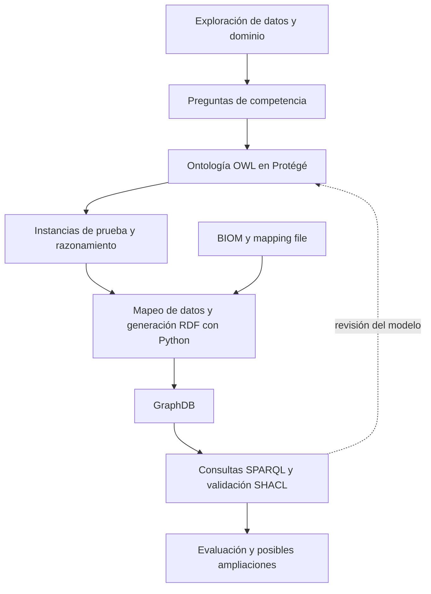

# EMPKG-lite — Earth Microbiome Project Knowledge Graph

Trabajo de Fin de Grado orientado a la construcción de un grafo de conocimiento de comunidades microbianas a partir de datos del [Earth Microbiome Project (EMP)](https://earthmicrobiome.org/).

## Objetivo

Integrar información metataxonómica y metadatos ambientales en un modelo semántico consultable, que permita relacionar muestras, variantes de secuencia, anotaciones taxonómicas, recuentos de lecturas, estudios y contexto ambiental. El proyecto busca preservar la identidad, el significado y la procedencia de los datos, reutilizando ontologías de referencia cuando resulte adecuado.

EMPKG-lite constituye una primera implementación de alcance acotado de la propuesta original de un grafo microbiano a escala planetaria. La armonización asistida por modelos de lenguaje (LLM) forma parte de la motivación del proyecto, pero se abordará de forma controlada después de establecer un KG funcional y criterios de evaluación.

## Datos de partida

Se utiliza el subconjunto `subset_2k` de EMP Release 1:

| Archivo | Contenido |
|---|---|
| `emp_deblur_90bp.subset_2k.rare_5000.biom` | Matriz dispersa de recuentos de ASVs y anotaciones taxonómicas |
| `emp_qiime_mapping_subset_2k.tsv` | Metadatos de las muestras, estudios y ambientes |

Según la exploración realizada en el notebook del proyecto:

| Característica | Valor |
|---|---:|
| Muestras | 2.000 |
| ASVs distintas | 155.002 |
| Longitud de secuencia | 90 bases |
| Pares ASV-muestra con recuento positivo | 858.173 |
| Lecturas por muestra tras rarefacción | 5.000 |
| Categorías EMPO de nivel 3 | 17 |
| Columnas del mapping file | 76 |

El alcance inicial es el subconjunto completo de 2.000 muestras, no todo EMP Release 1. Los recuentos describen lecturas procesadas, no cantidades directas de microorganismos. La selección de muestras y el procesamiento limitan las conclusiones ecológicas que pueden extraerse.

## Metodología

Se adopta una estrategia iterativa **Ontology First**: comprender el dominio y establecer los requisitos, diseñar una ontología OWL, probarla con individuos representativos y desarrollar la transformación de datos conforme al modelo. El diseño se basa en toda la información disponible, sin reducirse a las columnas de una tabla ni exigir que todas se incorporen al grafo.



## Tecnologías

| Tecnología | Responsabilidad |
|---|---|
| Python, biom-format, h5py, pandas | Exploración y tratamiento de datos |
| Protégé y OWL | Diseño, formalización y razonamiento sobre la ontología |
| RDF, Turtle y RDFLib | Representación y generación automatizada de datos RDF |
| GraphDB | Almacenamiento y explotación del grafo |
| SPARQL | Consultas y comprobación de requisitos |
| SHACL | Validación de la calidad y estructura de los datos RDF |

Se evaluará la reutilización de EMPO, ENVO, NCBI Taxonomy/NCBITaxon, MIxS y otros vocabularios pertinentes. Su incorporación y versiones se decidirán durante el diseño.

## Reproducir la exploración

Desde la raíz del repositorio, con Conda instalado:

```bash
conda env create -f environment.yml
conda activate empkg
python scripts/download_data.py
python scripts/inspect_data.py
jupyter lab
```

Si el entorno `empkg` ya existe, basta con activarlo; para sincronizarlo con la definición del repositorio se puede ejecutar `conda env update -f environment.yml --prune`.

Abrir `notebooks/00_explore_biom.ipynb` y ejecutar sus celdas. El script de inspección genera informes de diagnóstico en `data/inspection/`; no constituye una validación exhaustiva. El notebook no modifica los datos de origen.

Los archivos originales se descargan en `data/raw/` desde [EMP Release 1](https://ftp.microbio.me/emp/release1/). Los datos de origen y los artefactos generados en `data/processed/` y `data/inspection/` no se versionan en Git.

## Estructura actual

```text
.
├── docs/
│   ├── notes/
│   │   ├── emp_bioinformatics_fundamentals.md
│   │   └── abd_empkg-lite.md
│   ├── decisions.md
│   ├── original_project_proposal.md
│   └── roadmap.md
├── notebooks/
│   └── 00_explore_biom.ipynb
├── scripts/
│   ├── download_data.py
│   └── inspect_data.py
├── environment.yml
├── LICENSE
└── README.md
```

Las carpetas de ontologías, consultas, shapes, código reutilizable y pruebas se incorporarán según se necesiten.

## Estado y documentación

La exploración inicial está completada. La implementación RDF v0 fue una prueba de concepto, retirada de la rama de trabajo en favor de un diseño ontológico explícito. La ontología OWL v1 y el nuevo pipeline de población están pendientes; todavía no se presenta un KG v1 operativo.

- [Roadmap](docs/roadmap.md): planificación y entregables.
- [Registro de decisiones](docs/decisions.md): justificación técnica y trazabilidad.
- [Fundamentos bioinformáticos y semánticos](docs/notes/emp_bioinformatics_fundamentals.md): apuntes de aprendizaje.
- [Apuntes ABD](docs/notes/abd_empkg-lite.md): antecedentes de modelado y aprendizaje.
- [Propuesta original](docs/original_project_proposal.md): planteamiento histórico, no especificación vigente.
