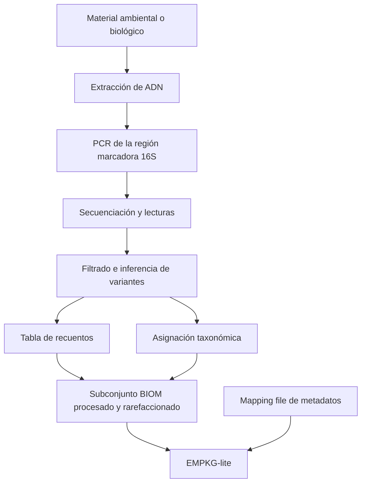
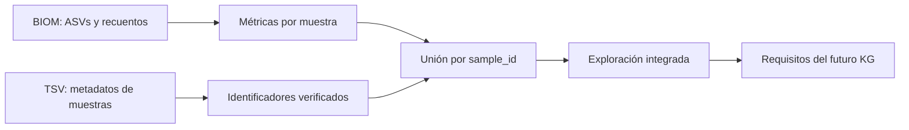
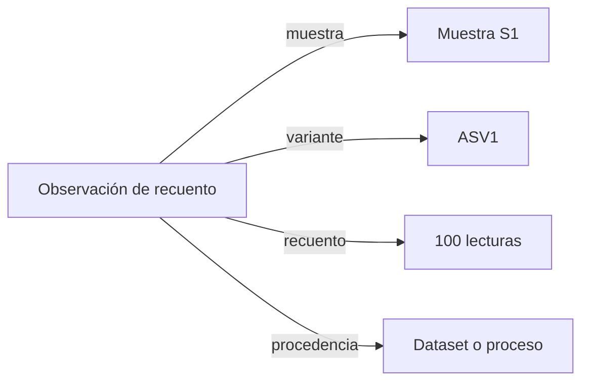
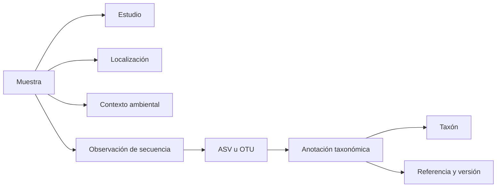

# Fundamentos bioinformáticos y semánticos del Earth Microbiome Project

*Exploración, comprensión e integración de datos microbianos para la construcción de un Knowledge Graph.*

**EMPKG-lite — Apuntes de aprendizaje del TFG**  
**Versión:** 17 de noviembre de 2026.

Este documento reúne los fundamentos científicos, computacionales y semánticos estudiados durante la revisión del notebook [`00_explore_biom.ipynb`](../../notebooks/00_explore_biom.ipynb). Está pensado como material de consulta para el TFG y para el estudio de bioinformática, no como especificación definitiva de la ontología ni como memoria final del proyecto.

**Cómo leerlo:** los resultados identificados como *EMP* proceden de las salidas guardadas en el notebook actualizado; los ejemplos didácticos son ficticios salvo indicación contraria. Las propuestas de representación del conocimiento son hipótesis de diseño que deberán contrastarse mediante preguntas de competencia, fuentes de referencia y validación. Las referencias numeradas enlazan a documentación y artículos de apoyo al final del documento.

## Índice

- [Fundamentos bioinformáticos y semánticos del Earth Microbiome Project](#fundamentos-bioinformáticos-y-semánticos-del-earth-microbiome-project)
  - [Índice](#índice)
  - [Parte I. Fundamentos de bioinformática](#parte-i-fundamentos-de-bioinformática)
    - [1.1. Microbiología y microbiomas](#11-microbiología-y-microbiomas)
    - [1.2. Metataxonomía frente a metagenómica shotgun](#12-metataxonomía-frente-a-metagenómica-shotgun)
    - [1.3. Secuenciación de amplicones y gen 16S](#13-secuenciación-de-amplicones-y-gen-16s)
    - [1.4. Lecturas, ASVs y OTUs](#14-lecturas-asvs-y-otus)
    - [1.5. Deblur, DADA2 y procesamiento bioinformático](#15-deblur-dada2-y-procesamiento-bioinformático)
  - [Parte II. Datos del Earth Microbiome Project](#parte-ii-datos-del-earth-microbiome-project)
    - [2.1. Introducción al EMP](#21-introducción-al-emp)
    - [2.2. EMP Release 1 y datasets disponibles](#22-emp-release-1-y-datasets-disponibles)
    - [2.3. Formato BIOM](#23-formato-biom)
    - [2.4. Formato HDF5](#24-formato-hdf5)
    - [2.5. Matrices dispersas: CSR y CSC](#25-matrices-dispersas-csr-y-csc)
    - [2.6. Librerías biom-format, h5py y Pandas](#26-librerías-biom-format-h5py-y-pandas)
  - [Parte III. Interpretación de los datos biológicos](#parte-iii-interpretación-de-los-datos-biológicos)
    - [3.1. Recuentos de lecturas](#31-recuentos-de-lecturas)
    - [3.2. Abundancia relativa](#32-abundancia-relativa)
    - [3.3. Riqueza y diversidad](#33-riqueza-y-diversidad)
    - [3.4. Prevalencia](#34-prevalencia)
    - [3.5. Rarefacción](#35-rarefacción)
    - [3.6. Taxonomía y linajes taxonómicos](#36-taxonomía-y-linajes-taxonómicos)
    - [3.7. Greengenes, SILVA y NCBI Taxonomy](#37-greengenes-silva-y-ncbi-taxonomy)
  - [Parte IV. Metadatos ambientales](#parte-iv-metadatos-ambientales)
    - [4.1. Estructura del mapping file](#41-estructura-del-mapping-file)
    - [4.2. Clasificación EMPO](#42-clasificación-empo)
    - [4.3. Environment Ontology (ENVO)](#43-environment-ontology-envo)
    - [4.4. Estándar MIxS](#44-estándar-mixs)
    - [4.5. Contexto ambiental y mediciones](#45-contexto-ambiental-y-mediciones)
    - [4.6. Valores ausentes y calidad de datos](#46-valores-ausentes-y-calidad-de-datos)
  - [Parte V. Aplicación a EMPKG-lite](#parte-v-aplicación-a-empkg-lite)
    - [5.1. Integración de BIOM y mapping file](#51-integración-de-biom-y-mapping-file)
    - [5.2. Identidad de los recursos](#52-identidad-de-los-recursos)
    - [5.3. Relaciones múltiples y recuentos](#53-relaciones-múltiples-y-recuentos)
    - [5.4. Open World Assumption](#54-open-world-assumption)
    - [5.5. Taxonomías y ontologías](#55-taxonomías-y-ontologías)
    - [5.6. Diferencias entre RDF, OWL y SHACL](#56-diferencias-entre-rdf-owl-y-shacl)
    - [5.7. Limitaciones y futuras ampliaciones](#57-limitaciones-y-futuras-ampliaciones)
  - [Apéndice A. Organización técnica y reproducibilidad](#apéndice-a-organización-técnica-y-reproducibilidad)
  - [Apéndice B. Preguntas de repaso y respuestas corregidas](#apéndice-b-preguntas-de-repaso-y-respuestas-corregidas)
    - [B.1. Fuentes, BIOM y almacenamiento](#b1-fuentes-biom-y-almacenamiento)
    - [B.2. Metataxonomía y métricas](#b2-metataxonomía-y-métricas)
    - [B.3. Taxonomía](#b3-taxonomía)
    - [B.4. Metadatos y semántica](#b4-metadatos-y-semántica)
  - [Glosario](#glosario)
  - [Referencias y fuentes de estudio](#referencias-y-fuentes-de-estudio)

---

<a name="parte-i-fundamentos-de-bioinformatica"></a>

## Parte I. Fundamentos de bioinformática

<a name="1-1-microbiologia-y-microbiomas"></a>

### 1.1. Microbiología y microbiomas

La microbiología estudia los microorganismos y sus interacciones. Bacterias, arqueas y hongos microscópicos pueden formar comunidades complejas en ambientes tan distintos como el suelo, el océano o el intestino. Estas comunidades intervienen en procesos como la descomposición de materia orgánica, los ciclos biogeoquímicos y las relaciones con organismos huéspedes.

Conviene distinguir:

| Concepto           | Significado                                                                                                           |
| ------------------ | --------------------------------------------------------------------------------------------------------------------- |
| Microorganismo     | Organismo microscópico individual.                                                                                    |
| Microbiota         | Conjunto de microorganismos que habitan un entorno.                                                                   |
| Microbioma         | Comunidad microbiana y, según la definición empleada, su material genético, actividad e interacciones con el entorno. |
| Muestra (*sample*) | Porción de material recogida para su análisis; no representa necesariamente todo el ecosistema.                       |
| Estudio (*study*)  | Investigación de procedencia que aporta contexto, objetivos y metodología a un conjunto de muestras.                  |

Un conjunto de muestras constituye una aproximación observacional a las comunidades naturales. La diversidad detectada depende del lugar, el momento, la cantidad de material recogida y el método analítico. La presencia de ADN tampoco demuestra por sí sola que los organismos estén vivos o sean metabólicamente activos.

EMPKG-lite busca integrar datos sobre las comunidades con su contexto. El significado de «muestra», «organismo», «secuencia» y «observación» debe permanecer diferenciado para evitar interpretaciones biológicas incorrectas.

<a name="1-2-metataxonomia-frente-a-metagenomica-shotgun"></a>

### 1.2. Metataxonomía frente a metagenómica shotgun

Ambos enfoques permiten estudiar comunidades microbianas sin cultivar individualmente todos sus miembros, pero analizan información diferente.

| Aspecto                | Metataxonomía (amplicones)                                        | Metagenómica shotgun                                                                   |
| ---------------------- | ----------------------------------------------------------------- | -------------------------------------------------------------------------------------- |
| Material secuenciado   | Regiones marcadoras seleccionadas mediante amplificación          | Fragmentos del ADN total extraído de la muestra                                        |
| Objetivo habitual      | Caracterizar la composición taxonómica                            | Caracterizar composición y potencial funcional/genético                                |
| Ejemplos de marcadores | 16S rRNA (bacterias/arqueas), ITS (hongos), 18S rRNA (eucariotas) | No depende de un único marcador                                                        |
| Resolución             | Limitada por el marcador, longitud y referencia                   | Puede mejorar la resolución, condicionada por cobertura, referencias y métodos         |
| Procesamiento          | Filtrado, inferencia de ASVs o agrupación en OTUs, clasificación  | Filtrado, clasificación de lecturas, ensamblaje y/o anotación, entre otras estrategias |

**Alcance del TFG:** el dataset actual procede de secuenciación de amplicones de la región V4 del gen 16S rRNA, con secuencias procesadas de 90 bases [1]. Es metataxonomía, no metagenómica shotgun. No permite deducir por sí solo el genoma completo ni la capacidad metabólica detallada de cada organismo.

<a name="1-3-secuenciacion-de-amplicones-y-gen-16s"></a>

### 1.3. Secuenciación de amplicones y gen 16S

El gen del ARN ribosómico 16S codifica una molécula que forma parte de la subunidad pequeña del ribosoma de bacterias y arqueas. Incluye regiones conservadas y regiones variables. Las primeras facilitan la selección de cebadores; las segundas aportan información para distinguir grupos taxonómicos. Las copias del gen pueden variar entre organismos e incluso dentro de un mismo genoma.

La PCR amplifica fragmentos seleccionados de ADN mediante cebadores. Los fragmentos amplificados se denominan amplicones. Tras la secuenciación se obtienen lecturas, con posibles errores y, habitualmente, información de calidad en los archivos FASTQ.



El diagrama resume conceptualmente las etapas; no pretende reproducir todos los parámetros ni el orden exacto de cada operación del EMP. Nuestro trabajo comienza en los datos ya procesados, no en la extracción de ADN ni en el tratamiento de FASTQ.

<a name="1-4-lecturas-asvs-y-otus"></a>

### 1.4. Lecturas, ASVs y OTUs

Una **lectura** (*read*) es una secuencia obtenida por el instrumento. Una **ASV** (*Amplicon Sequence Variant*) es una variante de secuencia inferida a partir de las lecturas después de controlar errores. Una **OTU** (*Operational Taxonomic Unit*) es una unidad operacional que agrupa secuencias según un procedimiento definido, frecuentemente basado en similitud.

| ASV                                                                           | OTU tradicional                                                       |
| ----------------------------------------------------------------------------- | --------------------------------------------------------------------- |
| Identificada por una secuencia concreta en el contexto de la región procesada | Identificada por un clúster, referencia o secuencia representativa    |
| Puede distinguir diferencias reales de un nucleótido                          | Puede reunir secuencias parecidas bajo un umbral                      |
| Se obtiene mediante inferencia/denoising                                      | Se obtiene mediante agrupación o asignación a clústeres de referencia |
| No equivale necesariamente a una especie                                      | Tampoco equivale necesariamente a una especie                         |

El 97 % utilizado históricamente para muchas OTUs es un umbral de **identidad de secuencia**, no una medida de sensibilidad ni de certeza taxonómica. Los algoritmos y sus parámetros pueden variar. Los métodos ASV surgieron como alternativa de mayor resolución a las OTUs tradicionales; no hay una regla general de que las OTUs estén sustituyendo a las ASVs [2].

Ejemplo didáctico (secuencias ya depuradas): `ACGTACGT`, `ACGTACGT` y `ACGTTCGT` corresponden a dos variantes exactas con recuentos 2 y 1. Un algoritmo de clustering podría agruparlas si cumplieran su criterio de similitud. Este ejemplo no representa una ejecución real de Deblur ni un clustering al 97 %.

**ASV ≠ especie ≠ célula.** Dos especies distintas pueden compartir exactamente la misma región marcadora, aunque sus genomas sean diferentes. Un organismo puede contener varias copias diferentes del gen 16S; por eso puede contribuir a más de una ASV. Una secuencia parcialmente coincidente no justifica identificar dos ASVs como iguales.

En EMP, las secuencias completas sirven como identificadores de las observaciones de la tabla Deblur. El notebook confirma 155.002 identificadores únicos de 90 bases. Este hecho no implica que existan 155.002 especies.

<a name="1-5-deblur-dada2-y-procesamiento-bioinformatico"></a>

### 1.5. Deblur, DADA2 y procesamiento bioinformático

Deblur y DADA2 son métodos de inferencia de variantes. Deblur emplea un modelo de errores para distinguir señales biológicas de ruido; DADA2 aprende un modelo de errores de las lecturas y permite inferir variantes con resolución de un nucleótido [3, 4]. Constituyen estrategias diferentes para una etapa similar del procesamiento.

No deben confundirse con las bases de datos taxonómicas: SILVA y Greengenes aportan secuencias y anotaciones de referencia para clasificar las variantes. Es posible obtener ASVs mediante Deblur o DADA2 y asignarles taxonomía utilizando SILVA. El clasificador, su configuración y la versión de la referencia influyen en los resultados.

La separación conceptual entre inferencia de variantes y asignación taxonómica será importante en EMPKG-lite: la secuencia de una ASV no debe cambiar de identidad solo porque se modifique su anotación taxonómica.

---

<a name="parte-ii-datos-del-earth-microbiome-project"></a>

## Parte II. Datos del Earth Microbiome Project

<a name="2-1-introduccion-al-emp"></a>

### 2.1. Introducción al EMP

El Earth Microbiome Project (EMP) estudia comunidades microbianas de múltiples ambientes del planeta empleando protocolos comunes y recopilando metadatos de las muestras. Su interés para el TFG es disponer de información microbiológica y ambiental que puede relacionarse entre estudios. El artículo de Thompson et al. (2017) describe su catálogo y la metodología de Release 1 [1].

La estandarización contribuye a la comparabilidad, pero no elimina los sesgos experimentales, las diferencias entre ambientes ni la heterogeneidad de los metadatos. El subconjunto seleccionado no es una muestra aleatoria de toda la biosfera.

<a name="2-2-emp-release-1-y-datasets-disponibles"></a>

### 2.2. EMP Release 1 y datasets disponibles

La publicación de Release 1 incluye tablas de variantes Deblur y tablas de OTUs de referencia (Greengenes/SILVA) y de referencia abierta. Las distintas tablas pueden tener criterios de selección, secuencias, profundidades y anotaciones diferentes. Antes de comparar datasets hay que verificar sus parámetros y los identificadores de muestra comunes [1].

**Archivos utilizados en el notebook:**

| Archivo                                    | Contenido                               | Tamaño observado |
| ------------------------------------------ | --------------------------------------- | ---------------: |
| `emp_deblur_90bp.subset_2k.rare_5000.biom` | Matriz de recuentos y taxonomía por ASV |         53,8 MiB |
| `emp_qiime_mapping_subset_2k.tsv`          | Metadatos de las muestras               |          1,5 MiB |

Fuente: [EMP Release 1](https://ftp.microbio.me/emp/release1/). Se almacenan en `data/raw/emp/release1/` y no se versionan en Git. El archivo BIOM actual tiene profundidad 5.000 lecturas y 2.000 muestras; no debe extrapolarse ese requisito a todas las tablas EMP.

**Preparación reproducible**, desde la raíz del repositorio:

```bash
# Crear el entorno solo si aún no existe
conda env create -f environment.yml
conda activate empkg
python scripts/download_data.py
jupyter lab
```

Descarga manual alternativa mediante HTTPS (aunque el nombre del servidor contiene `ftp`):

```bash
BASE_URL="https://ftp.microbio.me/emp/release1"
DATA_RAW="data/raw/emp/release1"

wget -P "$DATA_RAW/mapping_files" \
    "$BASE_URL/mapping_files/emp_qiime_mapping_subset_2k.tsv"

wget -P "$DATA_RAW/otu_tables/deblur" \
    "$BASE_URL/otu_tables/deblur/emp_deblur_90bp.subset_2k.rare_5000.biom"
```

Ejecutar las descargas solo si faltan los archivos. La comprobación de existencia y tamaño no garantiza integridad completa; sería conveniente incorporar verificaciones de integridad y versiones al pipeline. No se ha comprobado el acceso FTP clásico: las URLs anteriores usan HTTPS.

<a name="2-3-formato-biom"></a>

### 2.3. Formato BIOM

BIOM (*Biological Observation Matrix*) define una estructura para matrices de observaciones biológicas con identificadores y metadatos asociados. BIOM 1.0 utiliza JSON; BIOM 2.x utiliza HDF5 [5]. En nuestra tabla las filas representan ASVs y las columnas muestras.

Ejemplo ficticio de una matriz de recuentos:

| Observación |   S1 |   S2 |   S3 |
| ----------- | ---: | ---: | ---: |
| ASV1        |   25 |    0 |   75 |
| ASV2        |    0 |   10 |   20 |
| ASV3        |   30 |   40 |    0 |

La celda ASV1–S1 contiene 25 lecturas. No almacena la secuencia, los metadatos ambientales ni 25 microorganismos. Los IDs de ambas dimensiones y las anotaciones se almacenan aparte. El valor cero significa que no se registran lecturas para ese par en la tabla procesada: no demuestra la ausencia biológica en el entorno.

**Resultados EMP (notebook, secciones 4, 5 y 6):**

| Magnitud                         |       Valor |
| -------------------------------- | ----------: |
| Versión BIOM                     |         2.1 |
| Filas (ASVs distintas)           |     155.002 |
| Columnas (muestras)              |       2.000 |
| Posiciones posibles              | 310.004.000 |
| Elementos no cero (`nnz`)        |     858.173 |
| Densidad                         |    0,2768 % |
| Longitud de todas las secuencias |    90 bases |
| Lecturas totales retenidas       |  10.000.000 |
| Lecturas por muestra             |       5.000 |

`nnz` significa *number of nonzero elements*, no número de valores no nulos ni número de lecturas. Cada ASV puede contribuir a muchas posiciones no cero. El atributo `type = OTU table` es una categoría de la especificación BIOM, no evidencia de que las observaciones se hayan construido por clustering de OTUs.

<a name="2-4-formato-hdf5"></a>

### 2.4. Formato HDF5

HDF5 (*Hierarchical Data Format 5*) es un formato binario de propósito general para datos científicos. Organiza los datos en grupos (contenedores), datasets (arrays) y atributos (información adicional). BIOM define cómo emplear esa estructura para una tabla biológica; HDF5 no es por sí mismo un formato exclusivo de bioinformática.

Estructura observada en el archivo del EMP:

```text
/  [attrs: format-version, shape, nnz, generated-by, ...]
├── observation/
│   ├── ids                     (155002,)
│   ├── group-metadata/
│   ├── metadata/
│   │   └── taxonomy            (155002, 7)
│   └── matrix/                 CSR
│       ├── data                (858173,) float64
│       ├── indices             (858173,) int32
│       └── indptr              (155003,) int32
└── sample/
    ├── ids                     (2000,)
    ├── group-metadata/
    ├── metadata/               vacío en este archivo
    └── matrix/                 CSC
        ├── data                (858173,) float64
        ├── indices             (858173,) int32
        └── indptr              (2001,) int32
```

Los atributos guardados indican `generated-by = QIIME 1.9.1` y fecha de creación `2016-09-28T08:57:11.660674`. Son información de procedencia del archivo, no la fecha de recogida de todas las muestras ni la versión del entorno actual.

```python
import h5py

with h5py.File(BIOM_PATH, "r") as f:
    print(dict(f.attrs))
    f.visititems(lambda name, obj: print(name))
```

El modo `r` mantiene el archivo en solo lectura. `visititems()` recorre la jerarquía sin necesidad de cargar todos sus datasets.

<a name="2-5-matrices-dispersas-csr-y-csc"></a>

### 2.5. Matrices dispersas: CSR y CSC

Una matriz densa almacena todos los valores, incluidos los ceros. Una estructura dispersa almacena los valores relevantes y sus posiciones. En nuestro BIOM, aproximadamente el 99,7232 % de las celdas es cero. Un array denso `float64` con todas las posiciones ocuparía unos 2,31 GiB solo para los datos; los objetos auxiliares podrían aumentar ese consumo.

BIOM mantiene dos orientaciones de la matriz para acceso eficiente a ambos ejes [5]:

- CSR (*Compressed Sparse Row*): organizada por filas, para acceder a las muestras en las que aparece una ASV.
- CSC (*Compressed Sparse Column*): organizada por columnas, para acceder a las ASVs observadas en una muestra.

La misma información se ordena de manera distinta; no son dos conjuntos independientes de abundancias. Ambas orientaciones utilizan tres arrays:

| Array     | Significado                                                  |
| --------- | ------------------------------------------------------------ |
| `data`    | Recuentos almacenados (en nuestro caso positivos).           |
| `indices` | Posiciones del eje contrario: columnas en CSR, filas en CSC. |
| `indptr`  | Límites de cada fila o columna dentro de `data` e `indices`. |

Ejemplo ficticio:

```text
       S1 S2 S3 S4
ASV1    4  0  7  0
ASV2    0  0  0  0
ASV3    0  9  0  0

CSR: data    = [4, 7, 9]
     indices = [0, 2, 1]
     indptr  = [0, 2, 2, 3]

CSC: data    = [4, 9, 7]
     indices = [0, 2, 0]
     indptr  = [0, 1, 2, 3, 3]
```

Para extraer la fila `i` en CSR se utilizan `start = indptr[i]`, `end = indptr[i+1]`, `data[start:end]` e `indices[start:end]`. El límite final no se incluye. Dos punteros consecutivos iguales indican una fila vacía, como ASV2. `indptr` no apunta a los elementos cero: delimita segmentos de los arrays comprimidos. Su longitud es el número de filas (CSR) o columnas (CSC) más uno.

**Ejemplo real:** la primera ASV del BIOM se registra en dos muestras, `1627.LMC` (1 lectura) y `1627.ZCCK1` (18 lecturas). Sus punteros iniciales son 0 y 2. La primera muestra contiene 304 ASVs y 5.000 lecturas; sus punteros CSC iniciales son 0 y 304. Estos resultados se comprobaron tanto con HDF5 como con `biom-format` en el notebook.

La matriz dispersa permite evitar materializar los más de 310 millones de pares posibles. En el KG tampoco interesará generar sistemáticamente afirmaciones para todos los pares con valor cero; el alcance de las observaciones y del conjunto de datos deberá quedar claro.

<a name="2-6-librerias-biom-format-h5py-y-pandas"></a>

### 2.6. Librerías biom-format, h5py y Pandas

`biom-format` proporciona una API especializada, mientras que `h5py` facilita el acceso a la estructura física. Pandas permite trabajar con tablas, series indexadas, filtros, uniones y agregaciones. NumPy aporta operaciones numéricas; Matplotlib permite visualizar resultados de manera exploratoria.

| Operación                           | API                                                     |
| ----------------------------------- | ------------------------------------------------------- |
| Cargar tabla                        | `biom.load_table(str(BIOM_PATH))`                       |
| Dimensiones                         | `table.shape`                                           |
| Identificadores                     | `table.ids(axis="sample")` o `axis="observation"`       |
| Vector de recuentos                 | `table.data(id, axis=...)`                              |
| Recuento de un par                  | `table.get_value_by_ids(asv_id, sample_id)`             |
| Metadatos                           | `table.metadata(id=asv_id, axis="observation")`         |
| Sumas y número de elementos no cero | `table.sum(axis=...)`, `table.nonzero_counts(axis=...)` |

Ejemplo aplicado al notebook:

```python
sample_ids = list(table.ids(axis="sample"))
observation_ids = list(table.ids(axis="observation"))

sample_counts = pd.Series(
    table.data(sample_ids[0], axis="sample"),
    index=observation_ids,
)
sample_counts = sample_counts[sample_counts > 0]
```

`sample_counts > 0` genera una serie booleana; al utilizarla entre corchetes, se conservan únicamente los índices donde la condición es verdadera. Si la serie era `[25, 0, 120, 0, 15]`, queda `[25, 120, 15]` con sus IDs originales. La suma permanece en 160, pero la longitud pasa de 5 a 3. En `asv_counts` el índice consta de muestras en vez de ASVs, y se aplica la misma lógica. No se modifica la tabla BIOM original. Para calcular prevalencia, el denominador debe seguir siendo el total de muestras, no la longitud filtrada.

Versiones registradas en la ejecución adjunta: Python 3.11.15, biom-format 2.1.17, h5py 3.16.0, NumPy 2.4.6 y Pandas 3.0.3. Estos datos describen el entorno observado; `environment.yml` no garantiza por sí solo una reproducción exacta si no se fijan las versiones.

---

<a name="parte-iii-interpretacion-de-los-datos-biologicos"></a>

## Parte III. Interpretación de los datos biológicos

<a name="3-1-recuentos-de-lecturas"></a>

### 3.1. Recuentos de lecturas

Denotamos por `c(i,j)` el recuento de la ASV `i` en la muestra `j`. Es un dato procesado del EMP. El total por muestra suma todos sus recuentos; el total de una ASV suma sus recuentos en todas las muestras del conjunto analizado.

El término *abundancia absoluta* puede interpretarse como concentración real de organismos. En este proyecto es preferible hablar de recuentos de lecturas, pues el número de copias del marcador, la extracción, la PCR y la secuenciación pueden introducir sesgos. Incluso con miles de lecturas no podemos conocer directamente cuántas células se recogieron.

```python
sample_sums = table.sum(axis="sample")
observation_sums = table.sum(axis="observation")
```

Ambas sumas globales deben coincidir. En los resultados guardados, el total es 10.000.000. Se utilizan estructuras dispersas para no cargar la matriz entera a formato denso.

<a name="3-2-abundancia-relativa"></a>

### 3.2. Abundancia relativa

Es la proporción de lecturas de una muestra correspondientes a una ASV:

$$p_{ij} = \frac{c_{ij}}{\sum_k c_{kj}}$$

Se expresa como proporción entre 0 y 1, o porcentaje multiplicando por 100. Si una ASV tiene 250 lecturas y su muestra tiene 5.000, su abundancia relativa es 0,05 (5 %). El denominador debe ser positivo; una muestra sin lecturas no tiene una composición relativa definida por esta fórmula.

**Ejemplo EMP:** la ASV con mayor recuento de la primera muestra (`1883.2008.269.Crump.Artic.LTREB.main.lane2.NoIndex`) tiene 536 lecturas de 5.000: 10,72 %. La siguiente tiene 522: 10,44 %. La suma de todas las proporciones de esa muestra es 1,0.

```python
relative_abundance = sample_counts / sample_counts.sum()
assert np.isclose(relative_abundance.sum(), 1.0)
```

Las proporciones son composicionales: si aumenta una parte manteniendo un total fijo, otras proporciones deben disminuir. No debe interpretarse automáticamente un cambio relativo como un cambio en la concentración absoluta de microorganismos.

<a name="3-3-riqueza-y-diversidad"></a>

### 3.3. Riqueza y diversidad

La riqueza observada de una muestra es el número de ASVs con recuento positivo. Dos muestras con cinco ASVs pueden tener igual riqueza y distinta distribución de lecturas: una con cinco recuentos iguales y otra dominada por una sola ASV.

| ASV   | Muestra A | Muestra B |
| ----- | --------: | --------: |
| A     |        20 |        96 |
| B     |        20 |         1 |
| C     |        20 |         1 |
| D     |        20 |         1 |
| E     |        20 |         1 |
| Total |       100 |       100 |

Ambas tienen riqueza 5. La diversidad alfa describe características de una comunidad dentro de una muestra: índices como Shannon incorporan riqueza y distribución relativa; Simpson también considera la dominancia. La diversidad beta describe diferencias entre comunidades. Estos índices no se han calculado en profundidad en el notebook porque el TFG se centra en la integración semántica.

**Riqueza observada de EMP (2.000 muestras):** mínimo 1, primer cuartil 94, mediana 245,5, media 429,09, tercer cuartil 611 y máximo 2.438 ASVs. La heterogeneidad es considerable incluso con la misma profundidad. La mediana decimal no indica media ASV real: resulta de la agregación estadística.

```python
observed_asvs_per_sample = table.nonzero_counts(axis="sample")
```

Como cada elemento no cero pertenece a una sola muestra, la suma de las riquezas de todas las muestras coincide con `table.nnz = 858173`. Esta igualdad es una comprobación estructural, no una inferencia ecológica.

<a name="3-4-prevalencia"></a>

### 3.4. Prevalencia

La prevalencia observada de una ASV es la fracción de muestras de un conjunto en las que tiene recuento positivo.

$$\mathrm{prev}(i)=\frac{\#\{j:c_{ij}>0\}}{N_{\mathrm{muestras}}}$$

Una ASV presente en 100 de 2.000 muestras presenta una prevalencia del 5 %. Una ASV con miles de lecturas en una sola muestra puede tener prevalencia baja y abundancia alta. No son métricas intercambiables.

**EMP:** la primera ASV aparece en dos muestras, por lo que su prevalencia es 0,1 % (19 lecturas acumuladas). La mediana del número de muestras positivas por ASV es 2 y el máximo registrado es 614 (30,7 %). La mediana del recuento acumulado por ASV es 4 lecturas. Estas estadísticas describen el subconjunto, no el planeta.

```python
prevalence_per_asv = table.nonzero_counts(axis="observation")
prevalence = prevalence_per_asv / len(sample_ids)
assert prevalence_per_asv.sum() == table.nnz
```

Las expresiones `sum` y `nonzero_counts` funcionan sobre ambos ejes: la primera suma magnitudes, la segunda cuenta posiciones distintas de cero. Los resultados agregados se organizan en `sample_stats` (2.000 × 2) y `asv_stats` (155.002 × 3), con IDs como índices. No son tablas de producción exportadas por el notebook.

<a name="3-5-rarefaccion"></a>

### 3.5. Rarefacción

La rarefacción consiste en submuestrear lecturas aleatoriamente hasta una profundidad común, típicamente sin reemplazo. Por ejemplo, con muestras de 12.000, 8.500 y 3.000 lecturas, una profundidad objetivo de 5.000 conservaría las dos primeras con 5.000 y excluiría la tercera en ese análisis.

Permite reducir diferencias de profundidad en determinadas comparaciones, pero descarta lecturas, puede eliminar ASVs poco abundantes e introduce dependencia del submuestreo. No corrige todos los sesgos ni demuestra que una muestra excluida sea inválida. Una muestra con baja profundidad puede deberse a baja biomasa o a factores técnicos.

El archivo actual ya se encuentra rarefaccionado. No debemos volver a rarefaccionarlo sin una razón metodológica. El notebook verifica que las 2.000 muestras tienen exactamente 5.000 lecturas, no solo que todas tengan la misma profundidad:

```python
reads = sample_stats["biom_total_reads"]
assert reads.eq(5000).all()
```

Este resultado confirma las sumas observadas; la descripción del método original de rarefacción procede de EMP [1]. El valor total retenido no documenta el número original de lecturas antes de ese procedimiento.

<a name="3-6-taxonomia-y-linajes-taxonomicos"></a>

### 3.6. Taxonomía y linajes taxonómicos

La taxonomía clasifica organismos. Un **taxón** es un grupo concreto de organismos; un **rango** es su nivel de clasificación; un **linaje** es la sucesión de taxones que conduce desde categorías amplias hacia una más específica. La nomenclatura puede cambiar con revisiones científicas.

**Ejemplo real de la primera ASV del BIOM:**

| Rango en el dataset | Anotación original       | Interpretación      |
| ------------------- | ------------------------ | ------------------- |
| kingdom             | `k__Bacteria`            | Bacteria            |
| phylum              | `p__Proteobacteria`      | Proteobacteria      |
| class               | `c__Gammaproteobacteria` | Gammaproteobacteria |
| order               | `o__Alteromonadales`     | Alteromonadales     |
| family              | `f__Alteromonadaceae`    | Alteromonadaceae    |
| genus               | `g__Marinimicrobium`     | Marinimicrobium     |
| species             | `s__`                    | Sin asignación      |

`kingdom` y `k__` son etiquetas del esquema original; Bacteria y Archaea se suelen considerar dominios. Se conserva la nomenclatura de origen antes de armonizarla. Una asignación vacía no afirma que el organismo carezca de especie o género. La presencia de una etiqueta tampoco demuestra certeza de clasificación.

La función `parse_taxonomy()` del notebook separa prefijos y valores, mantiene los siete rangos y transforma `None`, cadenas vacías, `Unclassified` y prefijos sin nombre en valores ausentes. Un prefijo inesperado provoca una excepción para evitar una interpretación silenciosamente errónea. Este parser está diseñado para el dataset actual; no garantiza compatibilidad con todas las bases de datos. La anotación original debe conservarse en los datos de origen para distinguir, si fuera necesario, los motivos de ausencia.

**Cobertura empírica:** selección aleatoria sin reemplazo de 5.000 ASVs (semilla 42), obtenida tras corregir el parser.

| Rango   | Con asignación | Sin asignación | Cobertura |
| ------- | -------------: | -------------: | --------: |
| kingdom |          4.996 |              4 |   99,92 % |
| phylum  |          4.396 |            604 |   87,92 % |
| class   |          3.814 |          1.186 |   76,28 % |
| order   |          2.977 |          2.023 |   59,54 % |
| family  |          1.769 |          3.231 |   35,38 % |
| genus   |            696 |          4.304 |   13,92 % |
| species |             85 |          4.915 |    1,70 % |

La cobertura cae hacia los rangos específicos. Solo 85 de las 5.000 ASVs seleccionadas disponen de anotación a nivel de especie. Son proporciones de disponibilidad de anotaciones, **no porcentajes de precisión** ni proporciones de muestras biológicas. No son una evaluación exhaustiva de las 155.002 ASVs ni una medida de abundancia de organismos.

**Relacionar taxonomía y recuentos:** se unen las anotaciones y `asv_stats` por el ID completo de ASV:

```python
tax_sample_with_counts = tax_sample_df.join(
    asv_stats[["total_reads"]], how="left", validate="one_to_one"
)
assert tax_sample_with_counts["total_reads"].notna().all()
```

En el notebook original se sobrescribían los índices aleatorios por los primeros 5.000 IDs, asociando recuentos a anotaciones incorrectas. Esta unión conserva la identidad; `validate` detecta duplicados. En la nueva salida, Proteobacteria reúne 1.280 ASVs seleccionadas (25,60 %) y 154.716 lecturas acumuladas (51,57 % de las lecturas de esas 5.000 ASVs). Los filos sin asignación reúnen 604 ASVs (12,08 %) y 4.443 lecturas (1,48 %). `groupby(..., dropna=False)` conserva el grupo no asignado y `size` cuenta sus filas. No interpretar estos porcentajes como composición global de todas las muestras o del planeta.

<a name="3-7-greengenes-silva-y-ncbi-taxonomy"></a>

### 3.7. Greengenes, SILVA y NCBI Taxonomy

| Recurso       | Papel                                                                                                                            |
| ------------- | -------------------------------------------------------------------------------------------------------------------------------- |
| Greengenes    | Referencia de secuencias 16S y clasificación taxonómica; el notebook documenta Greengenes 13.8 para el dataset histórico.        |
| SILVA         | Referencia de secuencias ribosómicas y anotaciones; útil para nuevas clasificaciones y tablas OTU.                               |
| RDP           | Referencia y herramientas de clasificación de secuencias ribosómicas.                                                            |
| GTDB          | Clasificación de bacterias y arqueas basada en datos genómicos.                                                                  |
| NCBI Taxonomy | Identificadores y clasificación de organismos en recursos NCBI. NCBITaxon ofrece una representación ontológica de esa taxonomía. |

Dos ASVs pueden compartir el mismo linaje. A su vez, una ASV puede recibir clasificaciones diferentes según el procedimiento y la versión de la referencia. No es correcto sobrescribir una anotación por otra automáticamente, ni suponer que una referencia es siempre mejor.

Para el futuro KG conviene distinguir secuencia, anotación, taxón y procedencia. Una etiqueta de Greengenes no es automáticamente equivalente a una entidad NCBITaxon. Hay que verificar la correspondencia del rango, linaje y versión, y documentar las ambigüedades.

---

<a name="parte-iv-metadatos-ambientales"></a>

## Parte IV. Metadatos ambientales

<a name="4-1-estructura-del-mapping-file"></a>

### 4.1. Estructura del mapping file

El TSV aporta el contexto de las muestras. Tiene 2.000 filas y 76 columnas. Los IDs `#SampleID` coinciden con los IDs del eje `sample` del BIOM. `study_id` identifica el estudio de procedencia y no sustituye al identificador de muestra.

| Familia de campos       | Ejemplos                                                                           | Qué describe                                                              |
| ----------------------- | ---------------------------------------------------------------------------------- | ------------------------------------------------------------------------- |
| Identidad y procedencia | `#SampleID`, `study_id`, `doi`, `ebi_accession`                                    | Muestras, estudios, publicaciones y accesiones                            |
| Metodología             | `target_gene`, `target_subfragment`, `pcr_primers`                                 | Marcador y procesamiento experimental                                     |
| Clasificación ambiental | `empo_0` a `empo_3`                                                                | Categorías del EMP                                                        |
| Descripción ambiental   | `env_biome`, `env_feature`, `env_material`                                         | Contexto, entidad ambiental local, material                               |
| Jerarquía de biomas     | `envo_biome_0` a `envo_biome_5`                                                    | Ruta de etiquetas de bioma proporcionada por EMP                          |
| Geografía               | `country`, `latitude_deg`, `longitude_deg`, `depth_m`, `altitude_m`, `elevation_m` | Localización y posición                                                   |
| Fisicoquímica           | `ph`, `temperature_deg_c`, `salinity_psu`, `oxygen_mg_per_l` y nutrientes          | Mediciones del ambiente                                                   |
| Huésped                 | `host_taxid`, `host_genus`, `host_species`                                         | Clasificación del organismo huésped, no de las ASVs                       |
| Datos derivados         | `adiv_observed_otus`, `adiv_shannon`, campos `observations_*`                      | Métricas proporcionadas por el EMP; verificar método antes de compararlas |

La carga deliberadamente preserva texto y marcadores originales:

```python
mapping = pd.read_csv(
    MAPPING_PATH, sep="\t", dtype=str,
    keep_default_na=False, na_filter=False,
)
```

La conversión de tipos y estandarización se decidirá posteriormente. `adiv_observed_otus` no equivale automáticamente a `biom_observed_asvs`; su método de cálculo, tabla y profundidad deben conocerse antes de establecer equivalencias.

<a name="4-2-clasificacion-empo"></a>

### 4.2. Clasificación EMPO

EMPO (*Earth Microbiome Project Ontology*) clasifica ambientes microbianos en categorías jerárquicas y se relaciona con ontologías existentes [6]. Los niveles de nuestro subconjunto son:

```text
empo_0: EMP sample (2000)
├── empo_1: Free-living (981)
│   ├── empo_2: Non-saline (595)
│   │   └── empo_3: Soil, Water, Sediment, Surface y Aerosol (non-saline)
│   └── empo_2: Saline (386)
│       └── empo_3: Water, Sediment, Surface e Hypersaline (saline)
└── empo_1: Host-associated (1019)
    ├── empo_2: Animal (640)
    │   └── empo_3: Corpus, Distal gut, Proximal gut, Secretion y Surface
    └── empo_2: Plant (379)
        └── empo_3: Corpus, Rhizosphere y Surface
```

Distribución de las 17 categorías del nivel 3, obtenida en la ejecución del notebook:

| empo_3                |  Muestras |
| --------------------- | --------: |
| Aerosol (non-saline)  |        81 |
| Sediment (non-saline) |       128 |
| Soil (non-saline)     |       129 |
| Surface (non-saline)  |       128 |
| Water (non-saline)    |       129 |
| Hypersaline (saline)  |        13 |
| Sediment (saline)     |       128 |
| Surface (saline)      |       117 |
| Water (saline)        |       128 |
| Animal corpus         |       128 |
| Animal distal gut     |       128 |
| Animal proximal gut   |       128 |
| Animal secretion      |       113 |
| Animal surface        |       143 |
| Plant corpus          |       123 |
| Plant rhizosphere     |       128 |
| Plant surface         |       128 |
| **Total**             | **2.000** |

El nivel 0 es constante en este dataset; la distinción entre ambientes de vida libre y asociados a huéspedes corresponde al nivel 1. La ontología EMPO contiene categorías adicionales como controles y otros tipos de asociación que no están presentes en esta tabla. Las 17 categorías no constituyen un catálogo universal. La distribución casi equilibrada obedece al diseño de selección de muestras; no estima la frecuencia ambiental global [1].

`mapping.groupby(COLS_EMPO).size()` permite examinar rutas completas, evitando perder la relación entre niveles al contar cada columna por separado.

<a name="4-3-environment-ontology-envo"></a>

### 4.3. Environment Ontology (ENVO)

ENVO es una ontología de alcance general para describir entidades y procesos ambientales. EMPO proporciona una clasificación más compacta para las muestras del EMP; ENVO nos permite expresar el contexto con mayor granularidad y enlazar datos con otros proyectos [7, 8].

Los tres campos ambientales describen facetas complementarias:

| Campo          | Pregunta                                          | Ejemplo conceptual |
| -------------- | ------------------------------------------------- | ------------------ |
| `env_biome`    | ¿En qué contexto ecológico amplio?                | Bosque templado    |
| `env_feature`  | ¿Qué entidad ambiental local?                     | Río                |
| `env_material` | ¿Qué material se muestreó o rodeaba a la muestra? | Sedimento fluvial  |

Un río no constituye necesariamente una subclase de bosque y el sedimento no es una subclase de río. Son conceptos relacionados mediante otros tipos de relaciones. No debe deducirse una jerarquía OWL de las tres columnas por su orden.

Los campos `envo_biome_*` sí contienen rutas de clasificación de biomas aportadas por EMP. Ejemplo real de las primeras muestras del estudio 550: `biome → terrestrial biome → anthropogenic terrestrial biome → dense settlement biome → urban biome`. Es una ruta de etiquetas observada, no una prueba de axiomas de subclase entre términos ENVO de una versión determinada. No todas las rutas tienen seis niveles.

**Cardinalidad observada:** 40 etiquetas distintas en `env_biome`, 84 en `env_feature` y 40 en `env_material`. Estos números no son cantidades certificadas de conceptos ontológicos: distintos nombres pueden ser sinónimos, ambiguos o tener distinto significado según el contexto.

Una etiqueta `soil` es texto. El concepto ENVO `ENVO:00001998` tiene una IRI ([soil](http://purl.obolibrary.org/obo/ENVO_00001998)) y una definición formal. Vincular la etiqueta a ese concepto requiere verificar su significado y la versión de la ontología. Una IRI por sí sola tampoco garantiza que el mapeo sea correcto.

<a name="4-4-estandar-mixs"></a>

### 4.4. Estándar MIxS

MIxS (*Minimum Information about any (x) Sequence*) es un estándar del Genomic Standards Consortium que define información contextual mínima para datos de secuenciación [9]. No es una base de secuencias ni una ontología ambiental equivalente a ENVO; especifica campos y criterios de descripción, utilizando vocabularios adecuados.

Las denominaciones históricas del EMP se corresponden conceptualmente con los siguientes campos de MIxS:

| Campo EMP      | Campo MIxS        | Función                   |
| -------------- | ----------------- | ------------------------- |
| `env_biome`    | `env_broad_scale` | Contexto ambiental amplio |
| `env_feature`  | `env_local_scale` | Contexto local            |
| `env_material` | `env_medium`      | Medio o material          |

Es una correspondencia conceptual, no una conversión automática. No renombramos los campos originales hasta definir una política de integración compatible con la versión del estándar que utilicemos.

<a name="4-5-contexto-ambiental-y-mediciones"></a>

### 4.5. Contexto ambiental y mediciones

Las muestras pueden describirse mediante información geográfica, clasificación ambiental y mediciones. Ninguna de estas dimensiones es equivalente a las demás.

Ejemplo real del notebook: `632.Temperate.deciduous.forest`, clasificada como `Soil (non-saline)`, con etiqueta `temperate mixed forest biome`, pH 6,4 y 1.063 ASVs observadas en 5.000 lecturas. Otra muestra de suelo puede tener una riqueza y pH distintos.

Ejemplo didáctico: tres muestras de tipo `Water (saline)` tienen salinidades registradas de 35 PSU, 28 PSU y desconocida. La categoría ambiental no permite deducir que las tres tengan el mismo valor medido. Una futura regla SHACL podría exigir una medición, pero su incumplimiento no demuestra que la clasificación ambiental sea falsa.

Latitud y longitud expresan una posición, no la identidad de una muestra, ambiente o evento. Dos muestras pueden compartir coordenadas pero proceder de materiales, profundidades, fechas o huéspedes diferentes. Lo mismo ocurre con muestras de vida libre. La reutilización de recursos de localización necesita una política de identidad justificada; no es suficiente asumir que valores iguales identifican todos los aspectos del lugar.

Las columnas numéricas necesitan interpretación y unidades: pH es adimensional, `temperature_deg_c` está en grados Celsius, `depth_m` en metros y `oxygen_mg_per_l` expresa concentración en mg/L. Deben distinguirse profundidad, altitud y elevación. No imputar valores ausentes a partir de categorías sin evidencias o metodología explícita.

<a name="4-6-valores-ausentes-y-calidad-de-datos"></a>

### 4.6. Valores ausentes y calidad de datos

En la inspección previa se detectaron cuatro marcadores textuales de ausencia: cadena vacía, `nan`, `unknown` y `Missing: Not provided`. El notebook utiliza una comparación normalizada con `strip().lower()`; el valor numérico cero no se trata como ausencia. Otros datasets podrían contener marcadores que distingan datos desconocidos, no recogidos o no aplicables.

```python
MISSING_MARKERS = {"", "nan", "unknown", "missing: not provided"}

def is_missing(value):
    if pd.isna(value):
        return True
    return str(value).strip().lower() in MISSING_MARKERS

missing_mask = mapping[SELECTED_FIELDS].apply(
    lambda column: column.map(is_missing)
)
```

La máscara indica `True` cuando falta información. `missing_mask.sum()` cuenta ausencias por columna; `(~missing_mask).sum()` cuenta valores considerados disponibles. No se modifica la tabla original.

**Cobertura observada en EMP:** porcentajes sobre 2.000 muestras.

| Campo                                                                                             | Disponibles | Ausentes | Cobertura |
| ------------------------------------------------------------------------------------------------- | ----------: | -------: | --------: |
| `#SampleID`, `study_id`, `empo_0`–`empo_3`, `env_biome`, `env_feature`, `env_material` (cada uno) |       2.000 |        0 |     100 % |
| `envo_biome_0`, `envo_biome_1` (cada uno)                                                         |       2.000 |        0 |     100 % |
| `envo_biome_2`                                                                                    |       1.967 |       33 |   98,35 % |
| `envo_biome_3`                                                                                    |       1.443 |      557 |   72,15 % |
| `envo_biome_4`                                                                                    |         840 |    1.160 |   42,00 % |
| `envo_biome_5`                                                                                    |          78 |    1.922 |    3,90 % |
| `country`                                                                                         |       2.000 |        0 |     100 % |
| `latitude_deg`, `longitude_deg` (cada uno)                                                        |       1.998 |        2 |   99,90 % |
| `depth_m`                                                                                         |       1.750 |      250 |   87,50 % |
| `altitude_m`                                                                                      |       1.919 |       81 |   95,95 % |
| `elevation_m`                                                                                     |       1.981 |       19 |   99,05 % |
| `temperature_deg_c`                                                                               |         411 |    1.589 |   20,55 % |
| `ph`                                                                                              |         284 |    1.716 |   14,20 % |
| `salinity_psu`                                                                                    |         121 |    1.879 |    6,05 % |
| `oxygen_mg_per_l`                                                                                 |          26 |    1.974 |    1,30 % |

**Cobertura no equivale a calidad.** La presencia de texto no certifica unidades correctas, formatos numéricos válidos, exactitud geográfica o correspondencia con una ontología. La ausencia puede ser legítima, por ejemplo, cuando una medición no era aplicable. No eliminar muestras simplemente por no tener pH o salinidad, ni seleccionar únicamente casos completos para validar el KG: se introducirían sesgos y no comprobaríamos su comportamiento con información incompleta.

---

<a name="parte-v-aplicacion-a-empkg-lite"></a>

## Parte V. Aplicación a EMPKG-lite

<a name="5-1-integracion-de-biom-y-mapping-file"></a>

### 5.1. Integración de BIOM y mapping file

El BIOM aporta recuentos y taxonomía por ASV; el mapping file describe el contexto de las muestras. El punto de unión es `sample_id` (`#SampleID` en origen). La integración exige comprobar disponibilidad, unicidad, espacios adicionales y coincidencia de los IDs. El notebook ha confirmado 2.000 IDs únicos en cada fuente, 2.000 comunes y ninguna diferencia entre conjuntos.



La igualdad de conjuntos no verifica la unicidad: `set(["S1", "S1", "S2"]) == set(["S1", "S2"])` es verdadera, aunque una fuente contiene un duplicado. La cardinalidad debe comprobarse antes de unir los datos.

```python
assert mapping["#SampleID"].is_unique
assert len(sample_ids) == len(set(sample_ids))
assert set(mapping["#SampleID"]) == set(sample_ids)

mapping_preview = mapping.rename(
    columns={"#SampleID": "sample_id"}
).set_index("sample_id")
integrated_preview = mapping_preview.join(
    sample_stats, how="inner", validate="one_to_one"
)
assert len(integrated_preview) == len(sample_ids)
```

El ejemplo es una variante abreviada de la unión del notebook, que selecciona campos concretos. Permite consultar las métricas de muestras de suelo y sus descripciones ambientales. Esta integración tiene una finalidad exploratoria y didáctica. No constituye el pipeline definitivo de procesamiento y población del Knowledge Graph, que se desarrollará conforme a la futura ontología OWL.

En una futura tabla OTU, los conjuntos de IDs podrían no ser idénticos al TSV. En ese caso, antes de imponer una igualdad estricta habrá que definir el subconjunto de muestras analizado y registrar exclusiones y sus causas. Una unión interna sin comprobaciones puede eliminar silenciosamente muestras.

<a name="5-2-identidad-de-los-recursos"></a>

### 5.2. Identidad de los recursos

RDF identifica recursos mediante IRIs. Una estrategia de identificación debe distinguir recursos del dominio de registros de origen. Los identificadores de muestra y ASV se han comprobado únicos **dentro de los archivos estudiados**; no se ha demostrado unicidad universal entre todos los datasets, marcadores o versiones.

| Elemento             | Criterio que habrá que estudiar                                               |
| -------------------- | ----------------------------------------------------------------------------- |
| Muestra              | ID de origen y alcance del identificador, preservando estudio y procedencia   |
| ASV                  | Secuencia completa, región marcadora y contexto metodológico pertinente       |
| OTU                  | Identificador del clúster o referencia, método y versión                      |
| Taxón                | Referencia taxonómica y correspondencia comprobada con un identificador       |
| Lugar de muestreo    | Política de identidad geográfica; coordenadas no equivalen a muestra o evento |
| Anotación taxonómica | Rasgo anotado, referencia y versión; posible distinción entre ejecuciones     |

Conservar la cadena completa de las ASVs evita colisiones por truncamiento y garantiza uniones correctas. Una transformación a hash podría ser útil para IRIs compactas si se documenta, es determinista y conserva la secuencia original; no es una decisión tomada en este notebook.

No debe deducirse `owl:sameAs` a partir de una etiqueta igual, coordenadas coincidentes o asignaciones taxonómicas compartidas. La igualdad de identidad es una afirmación fuerte que requiere evidencia.

<a name="5-3-relaciones-multiples-y-recuentos"></a>

### 5.3. Relaciones múltiples y recuentos

La relación entre muestra y ASV es N:M. El recuento depende de ambas, y, si coexistieran distintas tablas o procedimientos, también de la procedencia de esa observación. Un total por muestra o por ASV es una métrica diferente del valor de la celda.

| ASV   |    S1 |    S2 |
| ----- | ----: | ----: |
| ASV1  |   100 |   400 |
| ASV2  |   200 |    50 |
| ASV3  | 4.700 | 4.550 |
| Total | 5.000 | 5.000 |

No podemos guardar simplemente `ASV1 readCount 100` y `ASV1 readCount 400` sin indicar a qué muestra corresponden. Tampoco podemos asignar todos los recuentos a S1 sin identificar las ASVs. En una base relacional, una tabla intermedia con clave `(sample_id, asv_id)` representa el par en el contexto de una tabla de origen. Si integramos varias tablas, posiblemente necesitaremos también `dataset_id` o un identificador de ejecución.

En RDF se puede adoptar un patrón de relación n-aria que represente la observación como recurso [14]:



Ejemplo didáctico Turtle, no vocabulario definitivo:

```turtle
@prefix ex: <https://example.org/empkg/> .

ex:obs1 a ex:ReadCountObservation ;
    ex:sample ex:S1 ;
    ex:sequenceFeature ex:ASV1 ;
    ex:readCount 100 ;
    ex:sourceDataset ex:DatasetA .
```

Los 858.173 pares positivos son candidatos a representar mediante algún patrón de observación, no un número predeterminado de triples. El tamaño final dependerá del modelo elegido. Conviene evitar materializar todas las combinaciones de recuento cero y documentar qué significa la ausencia de una observación.

**Datos originales y derivados:** el recuento proviene de la tabla EMP procesada; la abundancia relativa, riqueza y prevalencia son derivables. Si una ASV aparece en 100 de 2.000 muestras, su prevalencia es 5 %. Si se añaden 1.000 muestras negativas comparables al mismo conjunto, pasa a 3,33 %. Almacenarla sin identificar el conjunto o actualizar el valor causaría incoherencias. Podemos calcular métricas mediante SPARQL o materializarlas con procedencia y estrategia de actualización si el rendimiento lo justifica.

<a name="5-4-open-world-assumption"></a>

### 5.4. Open World Assumption

La hipótesis de mundo abierto (OWA) de OWL implica que no conocer una afirmación no permite concluir automáticamente su negación [12]. Es diferente del valor cero explícito de un recuento o medición y de una afirmación negativa.

```turtle
@prefix ex: <https://example.org/empkg/> .

ex:SampleA ex:temperature 20.0 ; ex:ph 7.2 ; ex:salinity 0.0 .
ex:SampleB ex:temperature 20.0 ; ex:ph 7.2 .
```

En A hay una medición registrada de salinidad igual a cero; en B no hay afirmación de salinidad. No podemos concluir que la salinidad de B sea cero o que no exista en la realidad. Tampoco debemos convertir un valor taxonómico ausente en un taxón biológico llamado `Unknown`.

La falta de una tripleta ASV-muestra es un caso similar, con una diferencia importante: si conocemos que una tabla completa registra todos los recuentos positivos de su dominio, podemos interpretar un par no presente como cero **en esa tabla**, pero no como ausencia biológica universal. Esa interpretación exige modelar el alcance y completitud del dataset; RDF/OWL no deducen automáticamente el cero.

La OWA no es la única razón para construir un KG. Una base relacional también puede almacenar `NULL`. El valor añadido está en la semántica formal, integración de fuentes, reutilización de vocabularios, identidad, relaciones y posibilidades de inferencia.

<a name="5-5-taxonomias-y-ontologias"></a>

### 5.5. Taxonomías y ontologías

Una taxonomía organiza entidades mediante clasificación. Una ontología formal representa conceptos, propiedades, relaciones y axiomas de un dominio. Puede incorporar taxonomías, pero también relaciones no jerárquicas y restricciones semánticas.



El diagrama ilustra necesidades del dominio, no una lista obligatoria de clases OWL. Una entidad puede ser una clase, individuo o recurso estructurado según su significado y el patrón empleado. Un rango taxonómico, una etiqueta y una clase biológica no deben confundirse.

El siguiente paso funcional consistirá en definir preguntas de competencia: qué hechos debe poder expresar el modelo y qué consultas debe responder. Ejemplos de preguntas preliminares:

- ¿Qué muestras clasificadas como suelo no salino registran una secuencia concreta?
- ¿Qué recuentos tiene una ASV y en qué muestras se observaron?
- ¿Qué anotaciones taxonómicas y versiones de referencia se asocian a una variante?
- ¿Qué muestras de un ambiente concreto tienen pH disponible, y cuáles carecen de información?

Estas preguntas ayudarán a decidir clases, relaciones y requisitos de validación. La estructura de las columnas es una fuente de requisitos, no la ontología en sí.

<a name="5-6-diferencias-entre-rdf-owl-y-shacl"></a>

### 5.6. Diferencias entre RDF, OWL y SHACL

| Tecnología | Función                                                               | Ejemplo                                                              |
| ---------- | --------------------------------------------------------------------- | -------------------------------------------------------------------- |
| RDF        | Modelo de datos basado en tripletas sujeto-predicado-objeto           | S1 pertenece al estudio 1001                                         |
| RDFS       | Vocabulario para clases, propiedades, jerarquía, dominio y rango      | Toda instancia de una subclase también es instancia de la superclase |
| OWL        | Lenguaje ontológico para axiomas y razonamiento formal                | Definir categorías y relaciones semánticas más expresivas            |
| SHACL      | Validación de grafos según formas y restricciones explícitas          | Exigir un identificador o un tipo numérico válido                    |
| SPARQL     | Consultas y operaciones sobre datos RDF                               | Recuperar muestras con pH disponible                                 |
| Turtle     | Serialización textual de RDF                                          | Guardar tripletas en un archivo `.ttl`                               |
| GraphDB    | Almacenamiento, consulta y razonamiento sobre RDF según configuración | Cargar y consultar el KG                                             |
| Protégé    | Editor de ontologías                                                  | Diseñar y evaluar el modelo OWL                                      |

RDF, OWL y SHACL resuelven problemas diferentes [11–13]. RDFS/OWL no funcionan como las restricciones de una base de datos relacional. Por ejemplo, declarar dominio y rango puede producir inferencias sobre tipos en vez de rechazar una tripleta. Una cardinalidad mínima en OWL tampoco valida necesariamente que un valor esté explícitamente registrado, debido a la OWA.

Ejemplo: una muestra clasificada como `Water (saline)` puede carecer de una medición de salinidad. RDF expresa la clasificación; OWL puede describir la semántica de esa categoría; SHACL puede comprobar si la medición está registrada cuando existe un requisito justificado. Un fallo de validación señala un incumplimiento de la forma, no demuestra que el hecho biológico sea falso.

La separación de responsabilidades evita imponer restricciones excesivas a los datos procedentes de EMP.

<a name="5-7-limitaciones-y-futuras-ampliaciones"></a>

### 5.7. Limitaciones y futuras ampliaciones

**Limitaciones confirmadas o inherentes al análisis:**

- El dataset estudiado es un subconjunto histórico de 2.000 muestras. Los resultados no representan necesariamente la composición de todos los ambientes del planeta.
- Se trabaja con datos procesados y rarefaccionados a 5.000 lecturas por muestra, no con FASTQ originales.
- Los recuentos dependen de sesgos técnicos y biológicos. Las ASVs de 90 bases no equivalen a especies o células.
- La cobertura taxonómica se calculó en 5.000 ASVs aleatorias; el parser y la asignación no se validaron exhaustivamente sobre todas las ASVs.
- Las etiquetas de contexto ambiental y valores numéricos requieren verificar validez, unidades y correspondencias semánticas. El notebook solo analiza disponibilidad y ejemplos.
- No se han realizado análisis estadísticos causales, ni construido una nueva ontología, ni validado un KG con SHACL en este notebook.

**Aplicación al proyecto:** conservar los datos originales, separar exploración de procesamiento, definir la ontología antes de adaptar la generación RDF y comprobar el modelo mediante consultas y validaciones. Las decisiones sobre materialización de métricas, identidad geográfica, representación de datos incompletos y políticas de anotación se tomarán posteriormente.

**Ampliación prevista, no implementada:** utilizar tablas OTU de EMP (por ejemplo, las basadas en SILVA) para evaluar si el modelo y el pipeline son extensibles más allá de Deblur. Una posible abstracción sería un concepto general de rasgo de secuencia (*sequence feature*) que distinga ASVs de OTUs. No se deben identificar OTUs y ASVs como si fueran la misma unidad. Antes de comparar resultados habrá que verificar profundidad, región, método, versión de referencia, intersección de muestras y tratamiento de ausencias; los distintos procedimientos pueden tener profundidades de rarefacción diferentes. Otra posibilidad es reclasificar las mismas ASVs con SILVA y comparar asignaciones sin cambiar necesariamente las variantes de partida.

La armonización mediante LLM, el mapeo a ENVO/NCBITaxon y la integración de nuevos datasets deben abordarse después de disponer de un modelo semántico funcional y criterios de calidad explícitos. Las sugerencias de un LLM no constituyen por sí mismas evidencia de equivalencia ontológica.

---

<a name="apendice-a-organizacion-tecnica-y-reproducibilidad"></a>

## Apéndice A. Organización técnica y reproducibilidad

El trabajo de reorganización separa los archivos originales, los resultados generados y los componentes versionados. Este apéndice recoge las decisiones de Git adoptadas en la conversación, sin sustituir al README ni a las instrucciones definitivas de ejecución.

| Ruta                              | Criterio                                                                                     |
| --------------------------------- | -------------------------------------------------------------------------------------------- |
| `data/raw/`                       | Datos descargados, conservados intactos localmente, ignorados por Git                        |
| `data/inspection/`                | Resultados regenerables de inspección, ignorados                                             |
| `data/processed/`                 | Resultados derivados (CSV, TTL), ignorados                                                   |
| `data/examples/`, `data/samples/` | Ejemplos y subconjuntos pequeños de prueba que pueden justificarse como archivos versionados |
| `notebooks/`                      | Exploración, aprendizaje y resultados interpretados                                          |
| `scripts/`                        | Procesos reproducibles                                                                       |
| `src/empkg/`                      | Código reutilizable, pendiente de consolidación                                              |
| `docs/notes/`                     | Apuntes técnicos y académicos                                                                |

Los archivos originales no se modifican; ello facilita la trazabilidad y la reproducibilidad. Los principios FAIR (localizables, accesibles, interoperables y reutilizables) orientan el trabajo de datos [15], aunque no prohíben literalmente modificar archivos. Preservar la fuente y registrar las transformaciones es una buena práctica que ayuda a cumplirlos.

Las reglas `.gitignore` deben basarse en finalidad y ubicación, no solo en extensiones como `*.tsv` o `*.txt`. `git rm --cached` retira archivos del índice sin borrar inmediatamente la copia local; los datos siguen presentes en commits anteriores. Antes de cambiar a ramas donde aún están versionados o integrar sus eliminaciones, conviene respaldar las copias locales fuera del repositorio.

**Flujo de ramas acordado:** `main` conserva hitos estables, `develop` integra cambios revisados y cada tarea tiene una rama temporal (`feature/`, `fix/`, `refactor/`, `chore/`, `docs/`, `experiment/`). Actualmente la reorganización se trabaja en `chore/repository-cleanup`. Los tags se han pospuesto por decisión del proyecto. El uso de merges explícitos `--no-ff` ayuda a visualizar la integración de tareas; `--ff-only` es adecuado para avanzar referencias sin crear merges artificiales.

No se pretende versionar indiscriminadamente todos los datos derivados ni rehacer la modularización en el notebook. Los apuntes explican el conocimiento aprendido; el notebook conserva código y evidencias; los scripts ejecutan procesos repetibles y la memoria final justificará metodología y resultados.

---

<a name="apendice-b-preguntas-de-repaso-y-respuestas-corregidas"></a>

## Apéndice B. Preguntas de repaso y respuestas corregidas

Estas preguntas condensan los ejercicios de comprensión de la conversación, con las respuestas finales corregidas. Sirven para comprobar que se comprenden los conceptos antes de trabajar con OWL y Protégé.

<a name="b-1-fuentes-biom-y-almacenamiento"></a>

### B.1. Fuentes, BIOM y almacenamiento

| Pregunta                                  | Respuesta                                                                                              |
| ----------------------------------------- | ------------------------------------------------------------------------------------------------------ |
| ¿Por qué necesitamos BIOM y mapping file? | El BIOM aporta secuencias, recuentos y taxonomía; el TSV, el contexto de las muestras. Se unen por ID. |
| ¿Qué contiene una celda BIOM?             | Un recuento de lecturas de una ASV en una muestra. Los IDs y metadatos están aparte.                   |
| ¿Qué diferencia BIOM de HDF5?             | BIOM define la estructura biológica; HDF5 es el formato binario jerárquico que usa BIOM 2.x.           |
| ¿Por qué conservar `data/raw/`?           | Para reproducir y auditar las transformaciones; los datos de origen permanecen intactos.               |
| ¿Por qué separar descargas del notebook?  | Evitar duplicación y mantener la adquisición independiente de la exploración.                          |
| ¿Por qué una matriz dispersa?             | Porque casi todas las combinaciones ASV-muestra tienen recuento cero.                                  |
| ¿Qué diferencia CSR de CSC?               | CSR facilita acceso por ASV (fila); CSC por muestra (columna).                                         |
| ¿Qué guardan `data`, `indices`, `indptr`? | Valores, posiciones del eje opuesto y límites de cada segmento.                                        |
| ¿Por qué `nnz` supera el número de ASVs?  | Una ASV puede tener recuentos positivos en varias muestras.                                            |
| ¿Un cero demuestra ausencia biológica?    | No, solo ausencia de lecturas registradas para ese par en la tabla procesada.                          |
| ¿Qué aporta `biom-format`?                | Una API especializada que abstrae HDF5 y facilita operaciones por ambos ejes.                          |

<a name="b-2-metataxonomia-y-metricas"></a>

### B.2. Metataxonomía y métricas

| Pregunta                                         | Respuesta                                                                                    |
| ------------------------------------------------ | -------------------------------------------------------------------------------------------- |
| ¿Lectura, ASV y microorganismo son equivalentes? | No: observación de secuenciación, variante inferida y organismo individual, respectivamente. |
| ¿ASV y OTU?                                      | Variante de secuencia concreta frente a unidad de agrupación operacional.                    |
| ¿Dos especies pueden compartir una ASV?          | Sí, si comparten la secuencia de la región analizada.                                        |
| ¿Qué significa 5.000 lecturas y 304 ASVs?        | Las 5.000 lecturas retenidas se distribuyen entre 304 variantes distintas.                   |
| ¿5.000 lecturas equivalen a 5.000 células?       | No: influyen las copias del marcador, PCR y otros sesgos.                                    |
| ¿De quién es el recuento?                        | Del par ASV-muestra en una tabla/proceso concreto.                                           |
| ¿Procesamos FASTQ?                               | No, partimos de tablas ya procesadas por EMP.                                                |
| ¿Qué abundancia relativa tiene 250/5.000?        | 5 % de las lecturas.                                                                         |
| ¿Misma riqueza implica misma diversidad?         | No, las distribuciones de abundancias pueden ser distintas.                                  |
| ¿Qué prevalencia tiene 100/2.000?                | 5 % de las muestras del conjunto.                                                            |
| ¿Puede haber alta abundancia y baja prevalencia? | Sí, por ejemplo, una ASV dominante en una única muestra.                                     |
| ¿Qué hace la rarefacción?                        | Submuestrea a una profundidad común, descartando lecturas y posiblemente muestras.           |
| ¿Por qué la suma de riquezas es `nnz`?           | Cada posición no cero se cuenta una vez en su columna.                                       |
| ¿Por qué no materializar todas las métricas?     | Son derivables; pueden quedar obsoletas si cambia su contexto o los datos.                   |

<a name="b-3-taxonomia"></a>

### B.3. Taxonomía

| Pregunta                                           | Respuesta                                                                                         |
| -------------------------------------------------- | ------------------------------------------------------------------------------------------------- |
| ¿Taxón, rango y linaje?                            | Grupo biológico, nivel de clasificación y sucesión de taxones, respectivamente.                   |
| ¿ASVs distintas con el mismo linaje?               | Sí; la identidad de secuencia es distinta de la identidad taxonómica.                             |
| ¿Deblur o SILVA?                                   | No son alternativas directas: uno infiere variantes, otro aporta referencias para clasificarlas.  |
| ¿Qué significa `g__`?                              | La anotación no proporciona género; no demuestra que no exista.                                   |
| ¿Cobertura del 90 % equivale a exactitud del 90 %? | No; solo indica que el 90 % de las ASVs analizadas tiene un valor anotado en ese rango.           |
| ¿Por qué conservar el ID completo?                 | Evitar colisiones y unir anotaciones y recuentos sin desalinearlos.                               |
| ¿Sobrescribir una anotación al cambiar de base?    | No automáticamente; conservar y distinguir procedencia y versiones.                               |
| ¿Taxonomía u ontología?                            | La taxonomía clasifica; la ontología permite además representar relaciones y axiomas del dominio. |

<a name="b-4-metadatos-y-semantica"></a>

### B.4. Metadatos y semántica

| Pregunta                                                      | Respuesta                                                                                                       |
| ------------------------------------------------------------- | --------------------------------------------------------------------------------------------------------------- |
| ¿Qué diferencia EMPO y ENVO?                                  | EMPO clasifica hábitats del EMP; ENVO tiene alcance ambiental más general y granular.                           |
| ¿Qué representan los cuatro niveles EMPO?                     | Raíz, asociación general, subcategoría y hábitat específico.                                                    |
| ¿Cómo describir sedimento de río en bosque templado?          | `env_biome`: bosque templado; `env_feature`: río; `env_material`: sedimento fluvial.                            |
| ¿Son subclases entre sí?                                      | No necesariamente; son facetas distintas del ambiente.                                                          |
| ¿Etiqueta o identificador ontológico?                         | La etiqueta es texto; la IRI referencia un concepto definido, después de verificar el mapeo.                    |
| ¿Descartar muestra sin pH?                                    | No por ese motivo; lo desconocido no equivale a falso o cero.                                                   |
| ¿Por qué comprobar unicidad e igualdad de conjuntos?          | Para evitar duplicados, multiplicación de filas y pérdidas durante uniones.                                     |
| ¿Mismas coordenadas, misma muestra?                           | No necesariamente: pueden diferir material, huésped, momento y profundidad.                                     |
| ¿Por qué no probar solo muestras completas?                   | Para evitar sesgo y comprobar la robustez ante información incompleta.                                          |
| ¿Clasificación salina equivale a medición?                    | No; una categoría y un valor experimental son hechos diferentes. SHACL puede exigir el valor si se justifica.   |
| ¿Por qué no construir la ontología directamente desde el TSV? | Porque las columnas describen almacenamiento y no determinan las entidades, semántica ni consultas del dominio. |

---

<a name="glosario"></a>

## Glosario

| Término           | Definición breve                                                                            |
| ----------------- | ------------------------------------------------------------------------------------------- |
| 16S rRNA          | ARN ribosómico de la subunidad pequeña de bacterias y arqueas; su gen se usa como marcador. |
| Amplicón          | Fragmento de ADN obtenido por amplificación.                                                |
| ASV               | Variante de secuencia de amplicón inferida.                                                 |
| BIOM              | Biological Observation Matrix.                                                              |
| CSV / TSV         | Texto tabular separado por comas / tabulaciones.                                            |
| CSR / CSC         | Representaciones dispersas comprimidas por filas / columnas.                                |
| Deblur / DADA2    | Métodos de inferencia de variantes de secuencia.                                            |
| EMP / EMPO        | Earth Microbiome Project / su clasificación ontológica ambiental.                           |
| ENVO              | Environment Ontology.                                                                       |
| EDA               | Análisis exploratorio de datos.                                                             |
| FAIR              | Principios de localización, acceso, interoperabilidad y reutilización.                      |
| HDF5              | Formato binario jerárquico de datos científicos.                                            |
| IRI               | Identificador internacionalizado de recurso.                                                |
| KG                | Knowledge Graph o grafo de conocimiento.                                                    |
| Linaje            | Sucesión de taxones en una clasificación.                                                   |
| MIxS              | Estándar de metadatos de secuenciación.                                                     |
| NNZ               | Número de elementos no cero.                                                                |
| OTU               | Unidad taxonómica operacional.                                                              |
| OWL / OWA         | Lenguaje de ontologías web / hipótesis de mundo abierto.                                    |
| PCR               | Reacción en cadena de la polimerasa.                                                        |
| Prevalencia       | Proporción de muestras con una observación positiva para una variante.                      |
| Procedencia       | Información sobre origen, método, versión y transformaciones de un dato.                    |
| Rarefacción       | Submuestreo a una profundidad objetivo.                                                     |
| RDF / RDFS        | Modelo de tripletas / vocabulario de esquemas RDF.                                          |
| Riqueza observada | Número de variantes distintas registradas en una muestra.                                   |
| SHACL             | Lenguaje para validar grafos RDF mediante formas.                                           |
| SILVA             | Base de datos de secuencias ribosómicas y taxonomía.                                        |
| SPARQL            | Lenguaje de consulta de datos RDF.                                                          |
| Taxón             | Grupo de organismos clasificado dentro de un sistema taxonómico.                            |
| Turtle            | Formato textual de serialización RDF.                                                       |

---

<a name="referencias-y-fuentes-de-estudio"></a>

## Referencias y fuentes de estudio

**Fuente de los resultados empíricos:** notebook [`00_explore_biom.ipynb`](../../notebooks/00_explore_biom.ipynb), secciones 4–9, versión revisada el 17 de noviembre de 2026. Las cifras de cobertura, métricas, ejemplos e identificadores proceden de sus salidas guardadas, no de una nueva ejecución independiente de este documento. Los archivos BIOM/TSV locales son necesarios para reproducirlas.

1. Thompson, L. R., et al. (2017). *A communal catalogue reveals Earth's multiscale microbial diversity*. Nature, 551, 457–463. [DOI: 10.1038/nature24621](https://doi.org/10.1038/nature24621) · [Texto completo](https://pmc.ncbi.nlm.nih.gov/articles/PMC6192678/). Metodología y contexto de EMP Release 1.
2. Callahan, B. J., McMurdie, P. J., y Holmes, S. P. (2017). *Exact sequence variants should replace operational taxonomic units in marker-gene data analysis*. ISME Journal, 11, 2639–2643. [DOI: 10.1038/ismej.2017.119](https://doi.org/10.1038/ismej.2017.119).
3. Amir, A., et al. (2017). *Deblur rapidly resolves single-nucleotide community sequence patterns*. mSystems, 2(2), e00191-16. [DOI: 10.1128/mSystems.00191-16](https://doi.org/10.1128/mSystems.00191-16).
4. Callahan, B. J., et al. (2016). *DADA2: High-resolution sample inference from Illumina amplicon data*. Nature Methods, 13, 581–583. [DOI: 10.1038/nmeth.3869](https://doi.org/10.1038/nmeth.3869).
5. BIOM Format. [Especificación BIOM 2.1](https://biom-format.org/documentation/format_versions/biom-2.1.html) y [documentación](https://biom-format.org/documentation/). Estructuras dispersas, metadatos y API.
6. Earth Microbiome Project. [EMP Ontology (EMPO)](https://earthmicrobiome.org/protocols-and-standards/empo/).
7. Earth Microbiome Project. [Metadata Guide](https://earthmicrobiome.org/protocols-and-standards/metadata-guide/).
8. Environment Ontology. [Repositorio ENVO](https://github.com/EnvironmentOntology/envo) y [concepto soil](http://purl.obolibrary.org/obo/ENVO_00001998).
9. Genomic Standards Consortium. [MIxS: catálogo de términos](https://genomicsstandardsconsortium.github.io/mixs/term_list/).
10. Recursos taxonómicos: [SILVA](https://www.arb-silva.de/), [NCBI Taxonomy](https://www.ncbi.nlm.nih.gov/taxonomy), [GTDB](https://gtdb.ecogenomic.org/), [RDP](https://rdp.cme.msu.edu/).
11. W3C (2014). [RDF 1.1 Concepts and Abstract Syntax](https://www.w3.org/TR/rdf11-concepts/) y [RDF Schema 1.1](https://www.w3.org/TR/rdf-schema/).
12. W3C (2012). [OWL 2 Web Ontology Language Primer, segunda edición](https://www.w3.org/TR/owl2-primer/).
13. W3C (2017). [Shapes Constraint Language (SHACL)](https://www.w3.org/TR/shacl/). Véase también [SPARQL 1.1 Query Language](https://www.w3.org/TR/sparql11-query/).
14. W3C (2006). [Defining N-ary Relations on the Semantic Web](https://www.w3.org/TR/swbp-n-aryRelations/). Nota técnica sobre patrones de representación de relaciones múltiples.
15. Wilkinson, M. D., et al. (2016). *The FAIR Guiding Principles for scientific data management and stewardship*. Scientific Data, 3, 160018. [DOI: 10.1038/sdata.2016.18](https://doi.org/10.1038/sdata.2016.18).

Recursos complementarios de programación: [h5py](https://docs.h5py.org/), [Pandas](https://pandas.pydata.org/docs/), [SciPy sparse](https://docs.scipy.org/doc/scipy/reference/sparse.html). Las páginas de referencia pueden actualizarse; antes de utilizarlas como fuentes de la memoria final conviene registrar la versión pertinente y revisar su contenido original.
