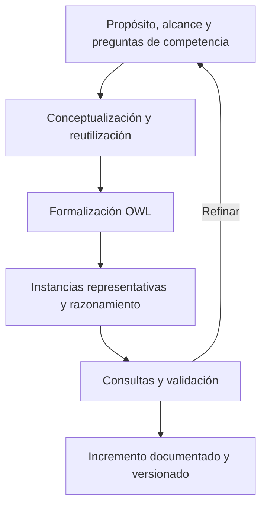

# Ingeniería ontológica y fundamentos de OWL

*EMPKG-lite — Apuntes de aprendizaje del TFG*  
**Versión:** 18 de noviembre de 2026.

Este documento continúa los [fundamentos bioinformáticos y semánticos](emp_bioinformatics_fundamentals.md) y los [apuntes de ABD](abd_empkg-lite.md). Recoge los bloques 1, 2.1 y 2.2 de aprendizaje y la teoría y prácticas propuestas del bloque 2.3. No constituye la especificación de la ontología EMPKG-lite v1. Los ejemplos son ficticios y sus clases, propiedades, axiomas e IRIs no son decisiones de producción. Las referencias al final permiten ampliar y verificar los conceptos.

## Índice

- [1. Ingeniería ontológica y metodología](#1-ingeniería-ontológica-y-metodología)
- [2. OWL y sus fundamentos](#2-owl-y-sus-fundamentos)
- [3. Protégé y organización de archivos](#3-protégé-y-organización-de-archivos)
- [4. Entidades, axiomas y propiedades](#4-entidades-axiomas-y-propiedades)
- [5. Semántica y razonamiento](#5-semántica-y-razonamiento)
- [6. Expresiones complejas y equivalencia](#6-expresiones-complejas-y-equivalencia)
- [7. Aplicación al dominio EMP](#7-aplicación-al-dominio-emp)
- [8. Prácticas y estado de aprendizaje](#8-prácticas-y-estado-de-aprendizaje)
- [9. Preguntas de repaso](#9-preguntas-de-repaso)
- [Referencias](#referencias)

## 1. Ingeniería ontológica y metodología

La ingeniería ontológica estudia cómo especificar, desarrollar, evaluar y mantener modelos formales del conocimiento de un dominio. Una ontología explicita conceptos, relaciones y axiomas; no es únicamente una tabla de categorías ni una traducción de columnas de una base de datos a clases. En EMPKG-lite interesa preservar el significado de los datos metataxonómicos, ambientales y de procedencia, y facilitar su integración y consulta.

### 1.1. Ontología y datos: TBox, ABox y RBox

| Componente (lógica descriptiva) | Función | Ejemplo didáctico |
|---|---|---|
| TBox | Conocimiento terminológico: clases y sus axiomas | `SoilSample SubClassOf Sample` |
| ABox | Afirmaciones sobre individuos | `sample_01 Types SoilSample` |
| RBox | Axiomas sobre relaciones o propiedades | `hasSample InverseOf belongsToStudy` (si ambas significan esa relación inversa) |

La distinción es conceptual: estos componentes pueden aparecer en el mismo documento OWL o separarse en archivos. En el proyecto se separarán el vocabulario, los datos generados y las formas de validación; esta división no obliga a un número concreto de archivos.

### 1.2. Enfoques metodológicos

| Enfoque | Aportación |
|---|---|
| Ontology First | Diseñar los requisitos y el modelo semántico antes del nuevo pipeline de población. Es la estrategia acordada (D04). |
| Ontology Development 101 [1] | Guía introductoria: delimitar alcance, considerar reutilización, identificar términos, organizar clases y propiedades, definir sus características y crear instancias. |
| LOT (Linked Open Terms) [2] | Marco iterativo de especificación de requisitos, implementación, publicación y mantenimiento. |
| METHONTOLOGY / NeOn | Alternativas mencionadas durante el estudio; aún no se han estudiado en profundidad ni seleccionado. |

**Propuesta metodológica:** emplear una adaptación ligera de LOT y Ontology Development 101 dentro del enfoque Ontology First. No se afirma una aplicación íntegra de LOT ni se ha ratificado con el tutor. El objetivo es evitar documentación innecesaria y mantener trazabilidad entre requisitos, decisiones, axiomas y pruebas.



Las preguntas de competencia expresan en lenguaje natural qué debe permitir responder el modelo. Por ejemplo, «¿qué recuentos tiene una ASV determinada en las muestras de suelo no salino?». Obligan a identificar muestras, ASVs, clasificación ambiental, recuentos y contexto de la tabla, sin fijar aún sus nombres ni cómo se representan. Después pueden traducirse a consultas de prueba y compararse con resultados conocidos. Las preguntas definitivas se definirán en la fase de requisitos.

Ontology First no significa diseñar una ontología exhaustiva sin tocar datos. Las pruebas pequeñas son necesarias para retroalimentar el modelo; el dataset completo `subset_2k` sigue determinando el alcance de diseño. No es necesario repetir la exploración general del BIOM/TSV.

## 2. OWL y sus fundamentos

OWL (Web Ontology Language) permite describir conocimiento con semántica formal. En OWL 2 DL, un razonador puede examinar consecuencias y consistencia conforme a su semántica directa [3, 4]. No es un lenguaje de programación ni un lenguaje de validación de registros.

| Tecnología | Responsabilidad en EMPKG-lite |
|---|---|
| RDF | Modelo de datos basado en tripletas |
| RDFS | Vocabulario de clases, propiedades, jerarquías, dominio y rango; inferencias básicas |
| OWL | Axiomas más expresivos (equivalencia, disjunción, restricciones, identidad, etc.) |
| Turtle | Serialización textual de RDF |
| Protégé / HermiT | Edición y razonamiento sobre la ontología experimental |
| Python / RDFLib | Generación programática de datos RDF |
| GraphDB / SPARQL | Almacenamiento y consulta; régimen de inferencia por determinar |
| SHACL | Comprobación de requisitos explícitos de calidad y estructura del grafo |

RDFS no declara por sí solo dos clases disjuntas. En OWL podemos expresar `:Sample owl:disjointWith :ASV` y detectar contradicciones si un individuo se clasifica en ambas. Una ontología consistente no garantiza que los datos sean completos, correctos biológicamente ni conformes a SHACL.

## 3. Protégé y organización de archivos

Protégé Desktop se ha instalado y utilizado para crear clases, propiedades, individuos, anotaciones, axiomas de disjunción, consultas DL y ejecutar HermiT. Las prácticas se realizan con una ontología independiente del modelo v1. No se pretende cargar manualmente toda la matriz BIOM en Protégé.

| Vista | Función |
|---|---|
| Active Ontology | IRI, anotaciones generales, prefijos e importaciones |
| Classes | Jerarquías declaradas e inferidas, axiomas de clase |
| Object Properties | Relaciones entre individuos, dominio y rango |
| Data Properties | Relaciones con valores de datos y rango de datatypes |
| Individuals (by class) | Tipos y afirmaciones de individuos |
| DL Query | Consultas de expresiones de clase en sintaxis Manchester con un razonador activo |

Si se modifican axiomas, sincronizar o reiniciar el razonador antes de interpretar las inferencias. `Reasoner → HermiT → Start Reasoner` (los rótulos pueden variar por versión). DL Query no sustituye SPARQL y la selección del razonador para el tutorial no fija el régimen de inferencia de GraphDB para el KG completo.

### 3.1. IRI, prefijo, etiqueta y archivo

| Elemento | Ejemplo experimental |
|---|---|
| IRI de ontología | `https://example.org/empkg/tutorial` |
| Namespace de entidades | `https://example.org/empkg/tutorial#` |
| IRI de clase | `https://example.org/empkg/tutorial#Sample` |
| Etiqueta | `EMPKG-lite Tutorial` |
| Archivo | `tutorial.ttl` |

El prefijo `:` abrevia IRIs; cambiarlo no renombra las entidades existentes. Cambiar la IRI de ontología tampoco modifica por sí solo las IRIs de todas las entidades. Si es necesario, usar las opciones de refactorización de Protégé y comprobar el archivo exportado. `@base` permite resolver IRIs relativas; no es una declaración de identidad de todos los recursos. En el primer tutorial se detectó una divergencia de namespaces entre las exportaciones Turtle y RDF/XML, corregida en la copia posterior. El dominio `example.org` se utiliza exclusivamente para ejemplos.

### 3.2. Serializaciones

Turtle (`.ttl`) y RDF/XML (`.rdf`) pueden representar el mismo grafo RDF. OWL es un lenguaje, no una extensión de archivo. `.owl` no identifica por sí sola una sintaxis; OWL/XML puede expresar axiomas OWL sin ser una serialización RDF. Manchester (`.omn`) facilita la lectura humana y las expresiones en Protégé; N-Triples (`.nt`) es otra serialización RDF.

Se propone Turtle como formato principal de la futura ontología por legibilidad, interoperabilidad con las herramientas del proyecto y revisión de cambios en Git. No hace falta duplicar la ontología en varios formatos. Comparar grafos (incluidos los nodos en blanco mediante isomorfismo), no solamente el texto, para comprobar equivalencia de serializaciones RDF. La IRI y el formato definitivo de producción se documentarán cuando proceda.

## 4. Entidades, axiomas y propiedades

Una entidad es un elemento identificado del vocabulario. OWL 2 distingue clases, individuos nombrados, propiedades de objeto, propiedades de datos, propiedades de anotación y datatypes. Un axioma es una afirmación formal; una expresión combina entidades y operadores para describir clases u otras construcciones complejas.

```text
Class: StudiedSample
    EquivalentTo: Sample and (belongsToStudy some Study)
```

`Sample` y `Study` son entidades; `Sample and (belongsToStudy some Study)` es una expresión de clase; la equivalencia forma un axioma.

### 4.1. Clases e individuos

`owl:Thing` contiene a todos los individuos; `owl:Nothing` es necesariamente vacía. Una clase puede tener varias superclases y un individuo varios tipos compatibles.

```turtle
:SoilSample a owl:Class ;
    rdfs:subClassOf :Sample ;
    owl:disjointWith :WaterSample .
:sample_01 a :SoilSample .
```

### 4.2. Propiedades

| Tipo | Relaciona | Ejemplo |
|---|---|---|
| `owl:ObjectProperty` | Individuo con individuo | `:sample_01 :belongsToStudy :study_01` |
| `owl:DatatypeProperty` | Individuo con valor de datos | `:sample_01 :hasPH 6.4` |
| `owl:AnnotationProperty` | Recurso con anotación | `:Sample rdfs:label "Muestra"@es` |

```turtle
:belongsToStudy a owl:ObjectProperty ;
    rdfs:domain :Sample ; rdfs:range :Study .
:hasPH a owl:DatatypeProperty ;
    rdfs:domain :Sample ; rdfs:range xsd:decimal .
:sample_03 :belongsToStudy :study_01 .
```

Domain y Range son axiomas: con las afirmaciones anteriores se deduce que `sample_03` pertenece a `Sample` y `study_01` a `Study`. Si se utiliza esa relación sobre una ASV, se inferirá que también es `Sample`; si `Sample` y `ASV` son disjuntas, la ontología resultará inconsistente. El rango de una propiedad de datos restringe semánticamente sus valores, pero no funciona como una regla SHACL que compruebe que exista una tripleta.

Tipos de datos útiles: `xsd:string` para identificadores y secuencias; `xsd:integer`, `xsd:nonNegativeInteger` o `xsd:positiveInteger` según el significado de recuentos; `xsd:decimal` para magnitudes decimales; `xsd:dateTime` para fechas con hora. Se elegirán según los datos y los requisitos reales.

Las anotaciones `rdfs:label`, `rdfs:comment`, `rdfs:seeAlso`, `owl:versionInfo` y `owl:deprecated` sirven para documentar. En la semántica directa de OWL las anotaciones no determinan las inferencias lógicas ordinarias. Una etiqueta no es una clave. Tampoco una propiedad `hasSampleID` implica unicidad sin axiomas o controles adicionales. Conservar la IRI, el identificador de origen y la etiqueta como conceptos distintos.

## 5. Semántica y razonamiento

### 5.1. Open World Assumption (OWA)

La falta de una afirmación no implica su negación. Para una ontología consistente, una afirmación puede ser consecuencia lógica, su negación puede ser consecuencia lógica, o ninguna de las dos puede deducirse. Esto no significa que OWL emplee lógica trivalente.

| Situación | Interpretación |
|---|---|
| `:sample_01 :hasPH 6.4` | Valor explícito |
| `:sample_01 :hasPH 0.0` | Valor explícito igual a cero |
| No consta `hasPH` | No se ha registrado un valor en ese grafo; no se infiere que no exista |
| `Sample and not (hasPH some xsd:decimal)` | Clase de muestras sin ningún valor decimal de pH, cuya pertenencia debe ser demostrable |

Las consultas DL `Sample and (hasPH some xsd:decimal)` y `Sample and not (hasPH some xsd:decimal)` no tienen por qué recuperar entre ambas todos los individuos nombrados de `Sample`: algunos quedarán indeterminados. En cambio, una consulta SPARQL con `FILTER NOT EXISTS` puede encontrar muestras sin tripleta coincidente en el grafo consultado; eso no es una negación lógica OWL.

Una etiqueta ambiental como `Water (saline)` no permite inferir por su nombre un valor medido de salinidad. Un axioma existencial con un rango positivo podría afirmar existencia de algún valor sin determinarlo, pero no debería confundirse clasificación con medición registrada. No se propone introducir ese axioma en producción sin justificación.

### 5.2. No Unique Name Assumption e identidad

Dos IRIs distintas son términos RDF diferentes, pero en OWL pueden designar el mismo individuo. Compartir valores tampoco determina igualdad por sí solo.

```turtle
:sample_A :hasSampleID "S1" .
:sample_B :hasPH 6.4 .
:sample_A owl:sameAs :sample_B .
```

Con la igualdad, el valor de pH es aplicable a `sample_A` y el identificador a `sample_B`. `owl:sameAs` expresa identidad estricta; es reflexiva, simétrica y transitiva y permite sustituir individuos en afirmaciones lógicas. No equivale a coincidencia parcial ni similitud. Las dos IRIs pueden seguir apareciendo como términos distintos en RDF/SPARQL.

`owl:differentFrom` afirma desigualdad; `owl:AllDifferent` permite declarar un conjunto de individuos mutuamente distintos. Afirmar igualdad y desigualdad simultáneamente produce inconsistencia.

También se pueden inferir identidades mediante axiomas adicionales. Por ejemplo, `:Sample owl:hasKey ( :hasSampleID )` permite inferir la igualdad de dos individuos nombrados de `Sample` que comparten un valor de esa clave (según las condiciones formales [4]). No valida unicidad como SQL, ni exige que el identificador esté presente. Este mecanismo se ha introducido conceptualmente, no estudiado en profundidad ni aprobado para el proyecto.

### 5.3. Consecuencia lógica (*entailment*)

Una afirmación es consecuencia de una ontología si es verdadera en todas sus interpretaciones que satisfacen los axiomas. Una interpretación asigna significado a individuos, clases y relaciones; si satisface todos los axiomas, es un modelo de la ontología.

- Conocimiento declarado (*asserted*): `SoilSample SubClassOf Sample` y `sample_01 Types SoilSample`.
- Conocimiento inferido (*inferred*): `sample_01 Types Sample`.
- Una consecuencia (*entailed*) puede estar ya declarada o deducirse de otras afirmaciones.

Las inferencias no verifican directamente la verdad empírica de los datos. Dependen de las premisas y del soporte semántico del razonador. No debe asumirse que GraphDB y HermiT producirán exactamente las mismas consecuencias.

### 5.4. Consistencia, satisfacibilidad y coherencia

| Concepto | Pregunta |
|---|---|
| Consistencia de la ontología | ¿Existe algún modelo que satisfaga todos sus axiomas? |
| Satisfacibilidad de una clase | ¿Existe un modelo de la ontología donde la clase tenga al menos un individuo? |
| Coherencia (criterio de ingeniería) | ¿Son satisfacibles todas las clases nombradas relevantes, excluyendo `owl:Nothing`? |

```text
Class: SoilSample
    DisjointWith: WaterSample
Class: MixedSample
    SubClassOf: SoilSample, WaterSample
```

`MixedSample` debe estar contenida en la intersección vacía de las dos clases disjuntas. Por tanto, es equivalente a `owl:Nothing`. Esto no impide que exista un modelo donde `MixedSample` esté vacía. Una clase sin individuos declarados puede ser satisfacible; una clase insatisfacible debe estar vacía en todo modelo.

| Experimento (resto de axiomas compatibles) | Consistente | Coherente |
|---|---|---|
| Modelo inicial | Sí | Sí |
| Añadir `MixedSample` | Sí | No |
| Añadir `mixed_sample_01 Types MixedSample` | No | No |
| Retirar la instancia | Sí | No |
| Retirar la clase problemática | Sí | Sí |

El mismo razonamiento se aplicó a `SpecialSample`, subclase de `Sample` y `ASV` disjuntas. Una ontología inconsistente no tiene modelos: hay que reparar la contradicción antes de interpretar resultados normales de inferencia. En Protégé pueden examinarse las clases insatisfacibles bajo `owl:Nothing` en la jerarquía inferida. Para EMPKG-lite se propone comprobar consistencia y coherencia como parte de la evaluación.

## 6. Expresiones complejas y equivalencia

**Estado:** teoría estudiada/presentada en el bloque 2.3; ejercicios propuestos, pendientes de confirmación y revisión. No se da por completado el bloque.

### 6.1. Constructores de clase

| Manchester | RDF/OWL | Significado |
|---|---|---|
| `A and B` | `owl:intersectionOf` | Individuos que pertenecen a ambas clases |
| `A or B` | `owl:unionOf` | Individuos que pertenecen a alguna de las clases o ambas |
| `not A` | `owl:complementOf` | Individuos que no pertenecen a A, respecto al dominio de interpretación |
| `A DisjointWith B` | `owl:disjointWith` | Axioma: no pueden compartir individuos; no es el operador `or` |

`Sample and not SoilSample` restringe el complemento a individuos de Sample. Si solo sabemos que `sample_03` es Sample, no podemos concluir que satisface ese complemento. Para una WaterSample sí podremos deducirlo cuando WaterSample y SoilSample sean disjuntas.

Una expresión de clase anónima puede consultarse en DL Query sin asignarle una IRI como clase nombrada. No es conveniente crear una clase permanente para cada combinación de filtros de consulta.

### 6.2. Condiciones necesarias y suficientes

```text
Class: AcidicSoilSample
    SubClassOf: SoilSample and AcidicSample
```

La pertenencia a `AcidicSoilSample` implica que se cumplen ambas condiciones; la dirección inversa no está garantizada. La clase puede ser solo una parte de la intersección.

```text
Class: AcidicSoilSample
    EquivalentTo: SoilSample and AcidicSample
```

La equivalencia establece también la dirección inversa: cualquier individuo que pertenezca a `SoilSample` y `AcidicSample` pertenece a `AcidicSoilSample`. No hace falta declarar ese tipo manualmente.

| Afirmación previa sobre una muestra | `SubClassOf` | `EquivalentTo` |
|---|---|---|
| Es SoilSample y AcidicSample | No garantiza que sea AcidicSoilSample | Se infiere AcidicSoilSample |
| Es AcidicSoilSample | Se infieren SoilSample y AcidicSample | Se infieren SoilSample y AcidicSample |
| Solo sabemos que es SoilSample | No se determina si es AcidicSoilSample | Tampoco se determina |

En una clase primitiva se describen condiciones necesarias sin definir completamente la pertenencia; una clase definida dispone de una caracterización por condiciones necesarias y suficientes. No todas las clases deben ser definidas de esa forma.

Equivalencia en Turtle:

```turtle
:AcidicSoilSample a owl:Class ;
    owl:equivalentClass [ a owl:Class ;
        owl:intersectionOf ( :SoilSample :AcidicSample ) ] .
```

### 6.3. Introducción a restricciones existenciales

```text
Class: StudiedSample
    EquivalentTo: Sample and (belongsToStudy some Study)
Class: AcidicSample
    EquivalentTo: Sample and (hasPH some xsd:decimal[< 7.0])
```

`some` expresa que existe al menos un valor que satisface la condición. En el segundo ejemplo, `sample_01` con pH 6,4 sería clasificada como AcidicSample. Una muestra sin valor conocido no queda automáticamente fuera de esa clase; tampoco un valor de pH igual o superior a 7 excluye que exista otro valor ácido si no se ha limitado la propiedad. La clasificación didáctica no pretende definir todas las condiciones científicas para caracterizar una muestra como ácida.

Las demás restricciones (`only`, `value`, `min`, `max`, `exactly`), las propiedades avanzadas y los perfiles OWL se estudiarán posteriormente. No se considera completada esa parte.

## 7. Aplicación al dominio EMP

### 7.1. Identidad y significado biológico

- Dos ASVs con secuencias distintas en el contexto del BIOM de Deblur de 90 bases son variantes distintas, aunque compartan género. `owl:sameAs` entre ambas sería una identificación errónea; compartir taxonomía no implica identidad. La ASV, el taxón y la asignación taxonómica con referencia y versión son conceptos diferentes.
- Coordenadas coincidentes no bastan para afirmar identidad de lugares, muestras ni eventos. La estrategia de identidad geográfica sigue pendiente.
- Una categoría EMPO es distinta de un valor medido y de una etiqueta ENVO. La reutilización de clases, propiedades o vocabularios externos requerirá comprobar sus IRIs, significado y versiones, no solo semejanza textual.

### 7.2. Recuentos como relaciones con atributos

El BIOM del proyecto contiene 2.000 muestras, 155.002 ASVs y 858.173 pares positivos. Un recuento describe lecturas procesadas, no células ni abundancia absoluta de organismos. Depende de la muestra, la variante y el contexto del dataset.

| | Sample 1 | Sample 2 |
|---|---:|---:|
| ASV 1 | 100 | 400 |
| ASV 2 | 200 | 50 |

Una propiedad `hasObservedASV` puede expresar la relación binaria, pero no conserva por sí sola el recuento de cada par. Guardar los recuentos directamente sobre la ASV o sobre la muestra pierde esa asociación. Un patrón de relación n-aria [7], análogo a una tabla intermedia con atributos, es una alternativa que habrá que evaluar:

```turtle
:obs_01 a :ReadCountObservation ;
    :sample :sample_01 ; :asv :asv_01 ;
    :readCount 100 ; :sourceDataset :DatasetA .
:obs_02 a :ReadCountObservation ;
    :sample :sample_02 ; :asv :asv_01 ;
    :readCount 400 ; :sourceDataset :DatasetA .
```

No se ha adoptado este vocabulario ni estimado el tamaño final del grafo con él. Evitar generar las más de 310 millones de combinaciones posibles de la matriz; la elección de representación de recuentos sigue abierta.

### 7.3. Ceros, ausencias y validación

Un cero en el BIOM completo significa que no se registraron lecturas de esa variante para esa muestra en la tabla procesada. La ausencia de una observación en RDF no implica automáticamente ese cero: solo podremos interpretarla así si verificamos la cobertura de todos los pares positivos del dataset y que la muestra y ASV pertenecen al dominio de esa tabla. No implica ausencia biológica. La rarefacción puede eliminar lecturas.

OWL permite expresar consecuencias lógicas del modelo; SHACL permite verificar que un grafo contiene propiedades requeridas, valores de un tipo válido, etc. Las formas SHACL deberán diseñarse a partir de requisitos, no imponer completitud arbitraria a datos ambientales incompletos. Por ejemplo, solo 284 muestras tienen pH disponible según la exploración. La ausencia de medición no debería excluir una muestra.

### 7.4. Decisiones que aún no están tomadas

No se han cerrado las preguntas de competencia, la reutilización de EMPO/ENVO/NCBITaxon/MIxS, el patrón de recuentos y procedencia, la identidad y los namespaces de producción, la cobertura de metadatos experimentales, la separación de axiomas y formas SHACL ni los criterios de evaluación. Las clases experimentales `AcidicSample`, `MixedSample`, `SoilSample`, etc. no se adoptan automáticamente. La contribución LLM y su prioridad deben ratificarse con el tutor conforme al roadmap.

## 8. Prácticas y estado de aprendizaje

### 8.1. Tutorial de Protégé

La última copia facilitada para revisión (`tutorial(1).ttl`) contiene 5 clases (`Sample`, `SoilSample`, `WaterSample`, `Study`, `ASV`), 2 propiedades de objeto, 3 propiedades de datos y 5 individuos nombrados; el namespace experimental está corregido. En esa copia `ASV` es disjunta de `Study`, no de `Sample`, y `sample_03` está tipada explícitamente como `Sample`. Se recomendó añadir la disjunción `Sample`/`ASV` y retirar el tipo explícito de `sample_03` para observar la inferencia de dominio. No se dispone de una copia posterior que confirme estos cambios. No se incluye el tutorial como ontología de producción.

| Práctica | Resultado o estado |
|---|---|
| Jerarquía de clases y disjunción SoilSample/WaterSample | Realizada según el usuario; estructura presente en el tutorial revisado |
| Propiedades de objeto/datos, anotaciones y dominio/rango | Práctica realizada; el archivo anterior requiere los ajustes indicados para demostrar exactamente la inferencia |
| Igualdad y desigualdad simultáneas | El usuario observó inconsistencia en HermiT; no se ha reproducido independientemente |
| Consultas DL y OWA | Comprensión comprobada en las respuestas; resultados esperados documentados |
| MixedSample y SpecialSample | Distinción entre insatisfacibilidad e inconsistencia consolidada mediante correcciones y repaso |
| Expresiones `and`, `or`, `not` y equivalencias | Teoría desarrollada y práctica propuesta; ejecución pendiente de acreditar |

Ejercicio de reanudación: definir `SoilOrWaterSample EquivalentTo SoilSample or WaterSample`, `NonSoilSample EquivalentTo Sample and not SoilSample`, `StudiedSample` y `AcidicSample` como en §6.3. Comparar los resultados de `AcidicSoilSample` usando primero `SubClassOf` y después `EquivalentTo`, sin declarar individuos de ella. Consultar las expresiones anónimas equivalentes. Comprobar el resultado en la jerarquía inferida. Si se mantiene el estado de los ejercicios previos, se espera que `sample_01` sea ácida y de suelo, `sample_02` sea de agua y no de suelo, y que las muestras sin clasificación ambiental no se clasifiquen automáticamente como no suelo. Verificar el archivo actualizado antes de afirmar resultados observados.

### 8.2. Siguientes pasos

1. Terminar y revisar el bloque 2.3; estudiar las restricciones y propiedades avanzadas esenciales sin demorar innecesariamente el diseño.
2. Delimitar los requisitos y las preguntas de competencia prioritarias, incorporando los acuerdos con el tutor.
3. Evaluar vocabularios y patrones de representación; elaborar un modelo conceptual mínimo con recuentos y taxonomía además de muestras.
4. Formalizar una primera ontología OWL y probarla con individuos representativos, razonamiento, consultas y validaciones, según el [roadmap](../roadmap.md).

La reunión con el tutor constituye una oportunidad de validar el alcance antes de invertir trabajo en decisiones ontológicas más costosas. No existe todavía una ontología v1 ni un nuevo KG funcional.

## 9. Preguntas de repaso

| Pregunta | Respuesta consolidada |
|---|---|
| ¿Una entidad OWL es siempre una clase? | No; también hay individuos nombrados, propiedades y datatypes. |
| ¿Un axioma y una expresión son lo mismo? | No; una expresión describe una construcción y puede participar en un axioma. |
| ¿Domain y Range rechazan tripletas? | Son axiomas semánticos; producen inferencias y pueden contribuir a contradicciones. |
| ¿Un pH no registrado es cero? | No; no se conoce el valor por esa ausencia. |
| ¿Dos IRIs distintas implican individuos diferentes? | No; no hay hipótesis de nombres únicos. |
| ¿Dos muestras con el mismo ID son automáticamente iguales? | No, salvo axiomas o evidencias que establezcan la identidad. |
| ¿Dos ASVs del mismo género pueden fusionarse? | No por compartir género; las secuencias distintas identifican variantes distintas en el contexto del dataset. |
| ¿Una clase insatisfacible implica inconsistencia global? | No necesariamente; puede estar vacía en todos los modelos. Si se exige una instancia, no existe modelo. |
| ¿Consistencia garantiza coherencia? | No; puede haber una clase nombrada insatisfacible en una ontología consistente. |
| ¿Cuál es la diferencia entre SubClassOf y EquivalentTo? | Condiciones necesarias frente a necesarias y suficientes respecto a la expresión indicada. |
| ¿La ausencia de una ASV en el grafo demuestra ausencia biológica? | No; para interpretar un cero del BIOM además se requiere conocer cobertura y contexto de la tabla. |
| ¿Basta una relación muestra–ASV para conservar el recuento? | No; hace falta representar el recuento asociado al par y contexto de origen. |

Las respuestas sobre expresiones complejas sintetizan la teoría presentada; no constituyen resultados de un cuestionario ya entregado por el estudiante.

## Referencias

1. Noy, N. F. y McGuinness, D. L. (2001). *Ontology Development 101: A Guide to Creating Your First Ontology*. Stanford. [Documento](https://protege.stanford.edu/publications/ontology_development/ontology101-noy-mcguinness.html).
2. Poveda-Villalón, M., Fernández-Izquierdo, A., Fernández-López, M. y García-Castro, R. (2022). *LOT: An industrial oriented ontology engineering framework*. Engineering Applications of Artificial Intelligence, 111, 104755. [DOI](https://doi.org/10.1016/j.engappai.2022.104755) · [Metodología](https://lot.linkeddata.es/).
3. W3C (2012). [OWL 2 Web Ontology Language Primer](https://www.w3.org/TR/owl2-primer/), 2.ª ed., especialmente §§3–5.
4. W3C (2012). [OWL 2 Direct Semantics](https://www.w3.org/TR/owl2-direct-semantics/) y [Structural Specification](https://www.w3.org/TR/owl2-syntax/). Semántica, identidad, consecuencias y problemas de inferencia.
5. W3C (2012). [OWL 2 Manchester Syntax](https://www.w3.org/TR/owl2-manchester-syntax/). Nota del grupo de trabajo.
6. Protégé. [Documentación oficial de Protégé 5](https://protegeproject.github.io/protege/).
7. W3C (2006). [Defining N-ary Relations on the Semantic Web](https://www.w3.org/TR/swbp-n-aryRelations/).
8. W3C (2017). [SHACL](https://www.w3.org/TR/shacl/); W3C (2013). [SPARQL 1.1 Query Language](https://www.w3.org/TR/sparql11-query/).
9. Egaña Aranguren, M. *Administración de Bases de Datos (UPV/EHU)*. [Tema OWL](https://github.com/mikel-egana-aranguren/EHU-ABD-01/tree/main/OWL).
