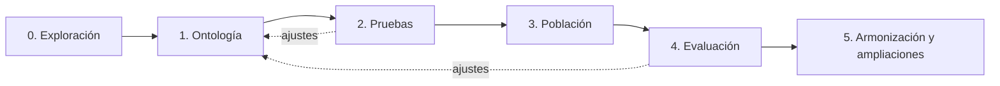

# Roadmap de EMPKG-lite

Este documento sustituye a `workflow.md` y `workflow_v2.md`. Define la planificación vigente tras la reorganización de noviembre de 2026. La metodología es iterativa: los resultados de las pruebas pueden exigir revisar el modelo o los requisitos.

## Alcance y prioridades

El objetivo central del TFG es construir y evaluar un KG funcional de datos del EMP mediante RDF/OWL, con una ontología explícita y un pipeline reproducible. El primer alcance comprende las 2.000 muestras del conjunto Deblur 90 bp rarefaccionado a 5.000 lecturas, sus ASVs, recuentos, anotaciones taxonómicas y metadatos pertinentes. Las pruebas reducidas no limitan el alcance del diseño.

No se pretende representar cada columna del mapping file automáticamente, realizar un estudio ecológico exhaustivo, reprocesar FASTQ ni integrar todo EMP Release 1 desde el inicio.

## Fases

| Fase | Objetivo                                                     | Estado                            |
| ---- | ------------------------------------------------------------ | --------------------------------- |
| 0    | Exploración del dominio y de los datos                       | Completada                        |
| 1    | Ingeniería ontológica                                        | En curso                          |
| 2    | Población experimental y validación del modelo               | Pendiente                         |
| 3    | Pipeline reproducible y población del conjunto completo      | Pendiente                         |
| 4    | Explotación del KG y evaluación                              | Pendiente                         |
| 5    | Armonización semántica asistida y evaluación de ampliaciones | Pendiente, según alcance acordado |

## Fase 0 — Exploración y preparación

**Objetivo:** comprender las fuentes de datos y sus limitaciones.

- [x] Configurar el entorno Python y adquirir los datos de EMP.
- [x] Explorar BIOM/HDF5, ASVs, recuentos, métricas y taxonomía.
- [x] Explorar EMPO, ENVO, metadatos y valores ausentes.
- [x] Comprobar la correspondencia y unicidad de los identificadores de muestra.
- [x] Construir una prueba de concepto RDF v0 y extraer aprendizajes.
- [x] Reorganizar el notebook de exploración y documentar los fundamentos.
- [x] Cerrar la reorganización documental e integrarla en `develop`.

**Entregables:** `notebooks/00_explore_biom.ipynb`, scripts de adquisición/inspección, apuntes y documentación actualizada. El prototipo RDF v0 queda accesible en Git como antecedente, no como modelo activo.

## Fase 1 — Ingeniería ontológica

**Objetivo:** definir qué conocimiento debe representar EMPKG-lite antes de implementar el pipeline.

- [x] Estudiar fundamentos de ingeniería ontológica e instalar y aprender el uso básico de Protégé.
- [x] Estudiar entidades, axiomas, propiedades, OWA, identidad, razonamiento, consistencia y satisfacibilidad; realizar ejercicios introductorios.
- [ ] Completar el estudio de expresiones complejas y equivalencias (teoría presentada; práctica pendiente de revisión), restricciones, propiedades avanzadas y perfiles OWL pertinentes.
- [ ] Delimitar dominio, propósito, alcance y requisitos junto al tutor cuando proceda.
- [ ] Formular y documentar preguntas de competencia y criterios de éxito.
- [ ] Evaluar ontologías y vocabularios reutilizables (EMPO, ENVO, NCBITaxon, MIxS y otros según necesidades); documentar licencias, versiones, IRIs y estrategia de reutilización.
- [ ] Diseñar el modelo conceptual: identidad de muestras y estudios, observaciones de secuencia, anotaciones taxonómicas, recuentos, ambiente, mediciones y procedencia.
- [ ] Resolver patrones de relaciones con atributos, identidad, unidades, información incompleta y evolución de referencias taxonómicas.
- [ ] Formalizar clases, propiedades, axiomas y anotaciones OWL en Protégé; revisar la consistencia mediante un razonador.

**Avance (18 de noviembre de 2026):** [apuntes de ingeniería ontológica y OWL](notes/ontology_engineering.md). Se ha trabajado con una ontología didáctica, no con EMPKG-lite v1. La adaptación de LOT y Ontology Development 101 es una propuesta; el alcance, las preguntas de competencia y el modelo formal siguen pendientes. Se priorizará contrastar el alcance y la contribución LLM con el tutor antes de cerrar el diseño.

**Entregables previstos:** ontología inicial (por ejemplo, `ontology/empkg.ttl`), preguntas de competencia, documentación del modelo y decisiones justificadas. Los nombres de clases y propiedades se definirán aquí, no se heredan automáticamente del RDF v0.

**Criterio de cierre:** alcance y preguntas documentados; modelo inicial coherente y preparado para probar sus casos de uso.

## Fase 2 — Población experimental y validación

**Objetivo:** comprobar que la ontología puede representar correctamente los datos y responder a los requisitos.

- [ ] Seleccionar un pequeño conjunto de casos de prueba, con metadatos completos e incompletos, coordenadas compartidas, múltiples ASVs por muestra, ASVs compartidas por muestras y anotaciones parciales.
- [ ] Crear individuos de prueba manualmente en Protégé o Turtle y revisar inferencias.
- [ ] Configurar un repositorio de pruebas en GraphDB; seleccionar y documentar el régimen de inferencia compatible con el modelo.
- [ ] Escribir consultas SPARQL correspondientes a las preguntas de competencia y contrastar resultados esperados.
- [ ] Definir shapes SHACL para requisitos de calidad justificados, distinguiéndolos de axiomas OWL.
- [ ] Ajustar el modelo y registrar los resultados, incluidos casos negativos.

**Entregables:** datos de prueba, consultas, shapes y resultados de validación. No se reutiliza automáticamente el antiguo conjunto de 17 muestras.

**Criterio de cierre:** casos representativos correctamente expresados, consultas con resultados verificables y validaciones acordes con los requisitos.

## Fase 3 — Pipeline reproducible y población del dataset

**Objetivo:** automatizar la creación del KG con las fuentes completas del alcance inicial.

- [ ] Definir una especificación de mapeo entre BIOM/TSV y el vocabulario OWL.
- [ ] Leer las fuentes preservando identificadores y valores originales. Normalizar ausencias y tipos con reglas documentadas.
- [ ] Generar IRIs estables mediante una estrategia de identidad justificada.
- [ ] Procesar la matriz dispersa eficientemente, preservando recuentos positivos y procedencia del procesamiento; evitar densificar la matriz completa.
- [ ] Representar anotaciones taxonómicas, metadatos y mediciones según el modelo aprobado. No confundir valores ausentes con ceros ni inferir taxones no sustentados.
- [ ] Desarrollar scripts Python/RDFLib y modularizar cuando exista lógica estable y reutilizable. Incorporar pruebas automatizadas.
- [ ] Ejecutar primero sobre casos de prueba y después sobre las 2.000 muestras, sin filtros de ASVs arbitrarios. Cargar en GraphDB y verificar cobertura, integridad y correspondencia con las fuentes.

**Entregables:** pipeline reproducible, mapeo documentado, tests, datos RDF generados y registro de carga. Se podrá usar un archivo intermedio si resulta necesario, pero el antiguo `sample_table.csv` no es un requisito arquitectónico.

**Criterio de cierre:** población del conjunto completo dentro del alcance definido, con errores y exclusiones (si las hay) explícitos, trazables y justificados.

## Fase 4 — Explotación y evaluación

**Objetivo:** demostrar el valor del KG y evaluar sus resultados.

- [ ] Ejecutar consultas SPARQL sobre datos ambientales, microbiológicos y taxonómicos.
- [ ] Contrastar resultados con BIOM y TSV, incluyendo recuentos y métricas agregadas.
- [ ] Evaluar cobertura de representación, resultados SHACL, consistencia, volumen de triples y rendimiento de consultas representativas.
- [ ] Documentar configuración, versiones, limitaciones, resultados reproducibles y decisiones en la memoria.

**Entregables:** conjunto de consultas, evaluación de calidad y rendimiento, documentación para la memoria y KG funcional.

## Fase 5 — Armonización semántica y posibles ampliaciones

La propuesta original incluye armonización asistida por LLM. Tras disponer de un KG básico, se podrá desarrollar y evaluar un componente para proponer correspondencias entre etiquetas ambientales y conceptos de referencia. La priorización y el carácter obligatorio de esta contribución deberán ratificarse con el tutor; no se presupone que haya quedado descartada.

- Comparar reglas deterministas, búsqueda de términos y propuestas LLM sobre etiquetas únicas.
- Verificar identificadores y compatibilidad semántica con la versión de la ontología de referencia; conservar etiqueta original, procedencia y estado de revisión.
- Evaluar aciertos, errores, ambigüedad y abstenciones sobre casos revisados. No insertar afirmaciones no verificadas automáticamente ni inventar mediciones o identificadores.

Otras ampliaciones, condicionadas al tiempo y resultados: tablas OTU del EMP con SILVA/Greengenes, nuevas asignaciones de ASVs, otros subconjuntos del EMP, visualización o hipótesis ecológicas. No se compromete su implementación en esta fase.

## Riesgos y medidas

| Riesgo                                     | Medida                                                                               |
| ------------------------------------------ | ------------------------------------------------------------------------------------ |
| Crecimiento del alcance                    | Priorizar preguntas de competencia y un KG funcional                                 |
| Gran tamaño del grafo                      | Procesamiento disperso, pruebas graduales y medición de recursos antes de escalar    |
| Mapeos taxonómicos o ambientales ambiguos  | Conservar originales, versiones y procedencia; revisión de correspondencias          |
| Datos incompletos                          | Representación parcial y validación explícita; no imputar ausencias sin fundamento   |
| Diferencias entre inferencia OWL y GraphDB | Seleccionar régimen de inferencia, contrastar con razonador y documentar diferencias |
| Desviación de la propuesta original        | Revisar alcance y papel del LLM con el tutor                                         |

## Gestión del desarrollo

- `main`: hitos estables y revisados.
- `develop`: integración de avances.
- Ramas temporales desde `develop`: tareas concretas (p. ej. `feature/ontology-v1`).
- Crear carpetas y entregables cuando sean necesarios; no modularizar por anticipado.
- Actualizar [decisions.md](decisions.md) ante decisiones relevantes y este roadmap cuando cambie la planificación.

No se fijan fechas artificiales: los criterios de cierre y los plazos académicos acordados determinarán el progreso.
